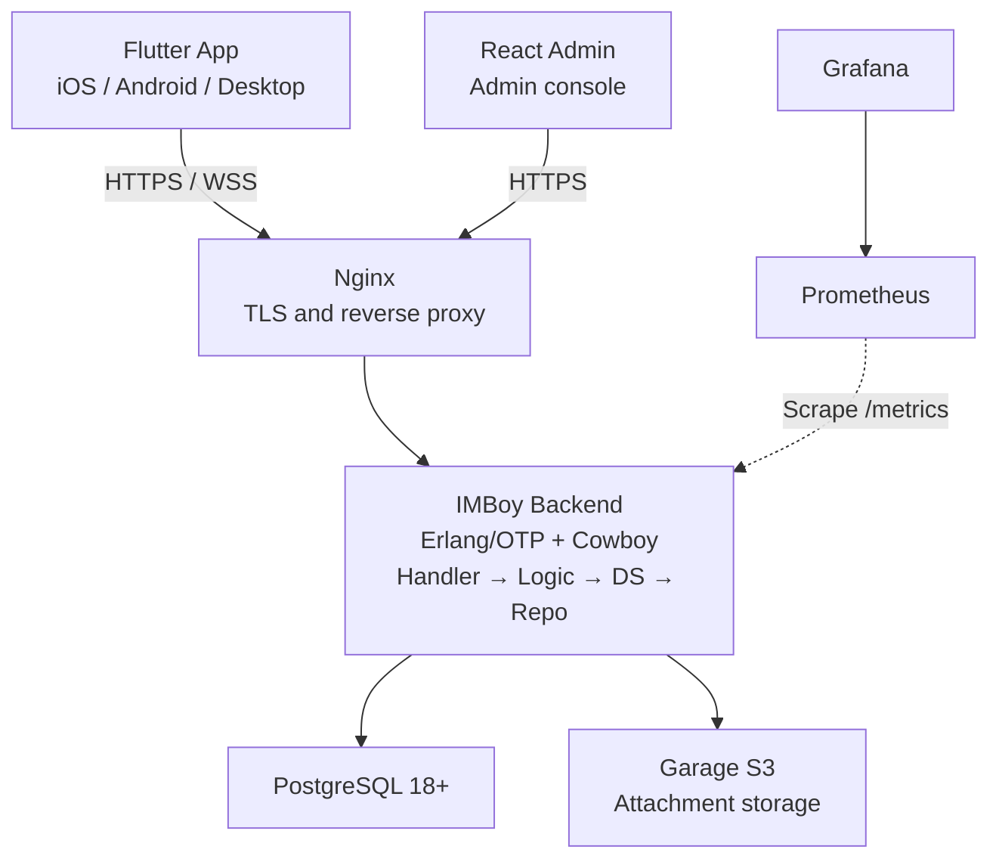

<p align="center">
  
</p>

# IMBoy Backend

[简体中文](./README.md)

IMBoy is a self-hostable instant messaging platform. This repository contains the Erlang/OTP backend, database migrations, production deployment files, and product documentation. The Flutter client and React admin console live in separate repositories.

## Features

Phase-1 delivery capability surface (`phase1_delivery` profile):

- One-on-one chat, group chat, and push notifications (Core IM: contacts, history/offline/multi-device sync, attachments and message governance)
- One-to-one voice/video calls between signed-in app friends (`rtc` is selected in the build manifest and allowed by the runtime preset by default; explicit `features.rtc=false` can disable it)
- Enterprise organizations/departments/members/workspaces with RBAC; human customer-service seats and visitor Widget; OA integration (internal API / SSO / Webhook)
- Channel foundation (in-organization General groups and announcement channels)
- Moments and nearby people (phase-1 scope; publishing, interactions, location and privacy controls require delivery-matrix acceptance)
- HTTP APIs and persistent WebSocket connections
- PostgreSQL persistence and direct uploads to Garage S3
- Single-node production deployment with Docker Compose (Helm/Kubernetes is experimental and not validated on a production cluster)

The repository also retains channel discovery/invitation/paid channels, end-to-end encryption (E2EE), group calls (`rtc_group`), Bots, the AI assistant, and other domains; build inclusion depends on the target manifest. Under the phase-1 delivery profile these domains are closed by delivery locks and fail-closed gates; stale caches or remote configuration cannot re-enable them. See the [packaging contract](./docs/product/packaging-contract.md) for phase boundaries, the whitelist, and delivery locks, and the [delivery package manifest](./docs/product/delivery-package-manifest.md) for package contents.

RTC build inclusion, effective runtime permission and real two-device media acceptance require separate evidence. The manifest profile does not switch the running server's profile. Visitor, web-seat and C2S audio/video are outside this delivery scope; group calls remain unselected and delivery-locked. See [packaging contract §9.5](./docs/product/packaging-contract.md#95-app-一对一-rtc-与群通话边界).

## System architecture



## Run locally

### 1. Requirements

- Erlang/OTP 28+
- GNU Make
- Docker

### 2. Initialize

```bash
bash scripts/dev_setup.sh
```

The script starts PostgreSQL 18 and creates `.env` and `config/sys.local.config`. Follow its prompt to make sure the database passwords match. Both local configuration files stay out of Git.

### 3. Build and start

```bash
make compile
IMBOYENV=local make run
```

After startup, open:

```text
http://127.0.0.1:9800/api/v1/init
```

To connect a phone to the local backend, replace `127.0.0.1` in the configuration with your computer's LAN IP address.

## Common commands

```bash
make compile                         # Compile
IMBOYENV=local make run              # Start the local server
make eunit                           # Run unit tests
make eunit-local                     # Test with local PostgreSQL
make dialyze                         # Run type analysis
make ctl ARGS="node status"          # Check node status
make ctl ARGS="db ping"              # Check the database
```

## Project map

```text
src/api/       HTTP and WebSocket request handling
src/adm/       Admin console APIs
src/logic/     Business logic
src/ds/        Data services and cache
src/repo/      PostgreSQL access
src/lib/       Shared infrastructure
priv/          Database migrations and static files
deploy/        Production deployment
docs/          Architecture, protocol, and operations docs
```

Business calls follow `Handler → Logic → DS → Repo`. A new endpoint usually needs a Handler, route, Logic code, and tests. Do not edit the vendored `erlang.mk`.

## Production deployment

The reference environment is **Debian 13 (Trixie)** (any x86_64 Linux works);
you need Docker 24+ with the Compose v2 plugin — if missing, `install.sh` offers
to install it via get.docker.com after confirmation.

### Three-step install (Community edition)

```bash
# 1) Clone the repository and enter the deploy directory
git clone <this repository> && cd imboy/deploy

# 2) If .env is absent, the first run copies the template and exits; then edit it
bash install.sh --edition community
#    Five distinct bare hostnames: API_DOMAIN / ADMIN_DOMAIN / CS_WIDGET_DOMAIN / RTC_DOMAIN / TURN_DOMAIN
#    Certificate email: CERTBOT_EMAIL; see the customer-input table below for other required fields

# 3) For a fresh community instance, explicitly authorize the missing cleanup LOGIN
bash install.sh --edition community --init-cleanup-db
```

Prepare the [customer inputs](./deploy/README.md#customer-input) first: five distinct
hostnames without schemes or paths, DNS pointing to the deployment ingress, public
TCP 80 for HTTP-01 validation, and TCP 443 for HTTPS/WSS. Also set
`IMBOY_BASE_URL=https://<API_DOMAIN>` and a dedicated `IMBOY_DIRECT_CLEANUP_PG_USER`.
For an existing account, supply its matching password. Community installation verifies
the account by default; `--init-cleanup-db` explicitly uses the existing `POSTGRES_USER`
administrative authority to create a missing LOGIN with database CONNECT and membership
in `v5_worker` only. Insufficient authority stops installation; it does not elevate
privileges or change existing accounts. See the [cleanup account guide](./deploy/standalone/docs/DB_CLEANUP_ACCOUNT.md)
for DBA steps, business deployments and external databases.

When `.env` is absent, the first run checks dependencies, copies the template and
exits. After you fill it in, the next run generates missing internal secrets and the
RSA login key pair, runs preflight, starts the stack, requests TLS certificates,
waits for health, checks the community cleanup identity against the running image's
migrations, positive/negative password authentication and role permissions, runs the
post-install self-check, and prints the Release Identity triple with the access URLs.
The PG image must include the initialization-script fix that disables password xtrace;
updating host scripts does not fix an old image. The delivery owner must verify the image.
Certificate issuance depends on real DNS and network
conditions; customer business flows still require on-site acceptance.

The first visit to the admin console opens the `/setup` wizard to create the
super admin; or pass credentials as arguments for a headless, browser-free
deployment:

```bash
bash install.sh --edition community --init-cleanup-db \
  --admin-phone 13800138000 --admin-password 'S3curePass2026' --yes
```

See `bash install.sh --help` for all options.

### Verify the installed image (Release Identity)

After installation the script prints:

```text
IMBOY_VERSION=...
IMBOY_GIT_SHA=...
IMBOY_IMAGE_DIGEST=sha256:...
```

Once official releases exist, the GitHub Release notes carry the same triple —
compare the two to confirm you installed the exact image the release gates
verified (see [RELEASES.md](./RELEASES.md)).

### Community vs Business edition

- **Community (default)**: the compose file `deploy/docker-compose.community.yml`
  ships with the repository and includes the Garage object storage (attachment
  upload works out of the box); the payment gateway is fixed off. The monitoring
  stack (Prometheus / Alertmanager / Loki / Promtail / Grafana) is off by default:

  ```bash
  docker compose -f docker-compose.community.yml --profile monitoring up -d
  ```

- **Business**: `deploy/docker-compose.prod.yml` is not distributed with the
  open-source repository; obtain it through the commercial channel (leeyisoft@qq.com).
  `deploy/docker-compose-sales-policy.yml` ships with the repository. Complete the
  business-specific configuration and run `bash install.sh --edition business` to
  combine both files (the script explains how to obtain missing files). Both editions
  require the five hostnames and customer inputs described above.

### Upgrading

In short: edit `IMBOY_VERSION` in `deploy/.env`, then `pull` + `up -d`
(migrations run automatically by default). Version history, per-release upgrade
notes, and rollback guidance live in [RELEASES.md](./RELEASES.md).

Full manual: the [deployment guide](./deploy/README.md).

## Quick demo (one command)

```bash
cd deploy
docker compose -f docker-compose.demo.yml up -d
# after ~30s open http://127.0.0.1:9800/api/v1/init
```

This example is for local product evaluation. Check configuration templates, ports
and health checks in the [deployment guide](./deploy/README.md) before starting.
Actual capabilities depend on the build manifest and effective runtime profile/features.
`phase1_delivery` allows one-to-one app-friend RTC by default and accepts
`features.rtc=false`; group calls, E2EE and AI remain disabled. A running demo does
not establish LiveKit/TURN readiness or real two-device media acceptance.

## More documentation

- [Documentation index](./docs/README.md)
- [Core concepts](./docs/concepts/README.md) (accounts / hierarchy / messaging / E2EE / agent / customer service / enterprise)
- [Glossary](./docs/glossary.md)
- [Backend architecture](./docs/architecture/overview.md)
- [REST API catalog](./docs/reference/rest-api-v1-catalog.md)
- [WebSocket protocol](./docs/reference/ws-protocol-contract.md)
- [Contributing](./CONTRIBUTING.md)
- [Security](./SECURITY.md)

## License

**Business Source License 1.1 (BSL 1.1)** — source-available, converting automatically to MPL 2.0 after four years.

- **Permitted**: copy, modify, redistribute; free for non-production use; production use that is internal to your organization, a dedicated deployment for a single end-customer, or embedded in your own product is free within the Additional Use Grant in [LICENSE](./LICENSE).
- **Commercial license required**: offering the software to third parties as a hosted, multi-tenant service (SaaS), or as a paid product or service that competes with the Licensor's paid version.

The three independently released sub-projects carry different licenses:

| Project | License | In short |
|---------|---------|----------|
| `imboy` (backend, this repository) | BSL 1.1 | Source-available, competitive commercial use restricted |
| `imboy-admin-frontend` (admin console) | BSL 1.1 | Source-available, competitive commercial use restricted |
| `imboy-flutter` (mobile client) | MulanPSL-2.0 | Fully open source |

Versions published before 2026-09-14 remain licensed under the [Mulan Permissive Software License, version 2](./docs/legal/MulanPSL-2.0.txt) and are unaffected by this change; that file is retained as the historical license text.

For commercial licensing, white-labeling, or trademark use, contact the maintainer. See [docs/legal/licensing.md](./docs/legal/licensing.md) for details.
