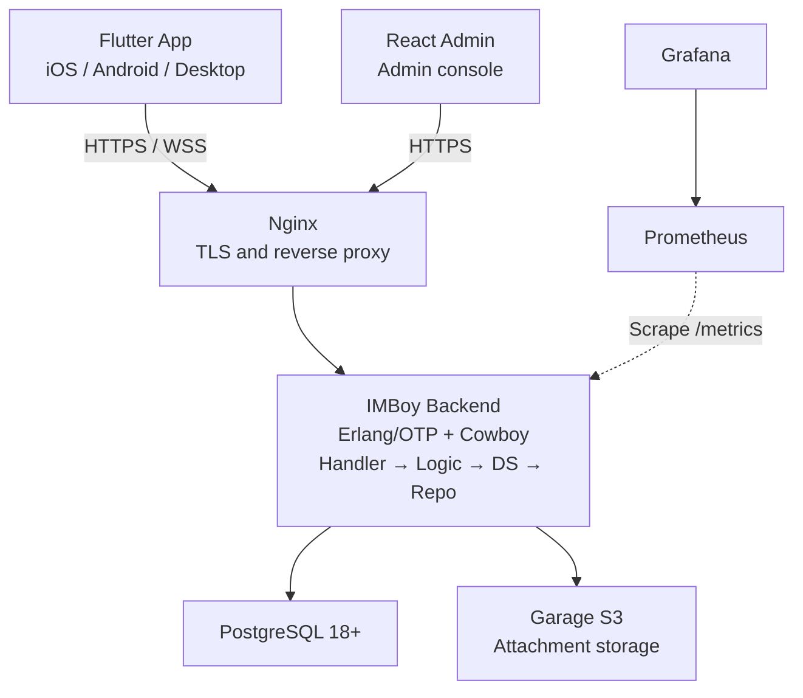

<p align="center">
  
</p>

# IMBoy Backend

[简体中文](./README.md)

IMBoy is a self-hostable instant messaging platform. This repository contains the Erlang/OTP backend, database migrations, production deployment files, and product documentation. The Flutter client and React admin console live in separate repositories.

## Features

Phase-1 delivery capability surface (`phase1_delivery` profile):

- One-on-one chat, group chat, and push notifications (Core IM: contacts, history/offline/multi-device sync, attachments and message governance)
- One-to-one voice/video calls between signed-in app friends (`rtc` is selected in the build manifest and allowed by the runtime preset by default; explicit `features.rtc=false` can disable it)
- Enterprise organizations/departments/members/workspaces with RBAC; human customer-service seats and visitor Widget; OA integration (internal API / SSO / Webhook)
- Channel foundation (in-organization General groups and announcement channels)
- Moments and nearby people (phase-1 scope; publishing, interactions, location and privacy controls require delivery-matrix acceptance)
- HTTP APIs and persistent WebSocket connections
- PostgreSQL persistence and direct uploads to Garage S3
- Single-node production deployment with Docker Compose (Helm/Kubernetes is experimental and not validated on a production cluster)

The repository also retains channel discovery/invitation/paid channels, end-to-end encryption (E2EE), group calls (`rtc_group`), Bots, the AI assistant, and other domains; build inclusion depends on the target manifest. Under the phase-1 delivery profile these domains are closed by delivery locks and fail-closed gates; stale caches or remote configuration cannot re-enable them. See the [packaging contract](./docs/product/packaging-contract.md) for phase boundaries, the whitelist, and delivery locks, and the [delivery package manifest](./docs/product/delivery-package-manifest.md) for package contents.

RTC build inclusion, effective runtime permission and real two-device media acceptance require separate evidence. The manifest profile does not switch the running server's profile. Visitor, web-seat and C2S audio/video are outside this delivery scope; group calls remain unselected and delivery-locked. See [packaging contract §9.5](./docs/product/packaging-contract.md#95-app-一对一-rtc-与群通话边界).

## System architecture



## Run locally

Prepare Docker 24+, Compose v2.23.1+, Bash and OpenSSL, then run from the repository root:

```bash
test -f .env || cp .env.example .env  # Preserve existing configuration
${EDITOR:-vi} .env    # Set both dev and pro database passwords
bash scripts/dev_setup.sh
```

The default stack starts PostgreSQL, Garage, API, Admin and Nginx, including the
attachment download edge. Open the [API](http://api.localhost:8080/api/v1/init) or
[Admin](http://admin.localhost:8080). On a fresh database, visit
[/setup](http://admin.localhost:8080/setup) to create the first superadmin; existing
instances keep their current accounts. LiveKit and Widget are opt-in; the local stack
does not start monitoring services. The first build and image downloads depend on your
network and machine; prepared images make subsequent starts faster.

```bash
bash scripts/dev_setup.sh --with-livekit --with-widget
```

For backend source development, use `bash scripts/dev_setup.sh --infra-only`, then
build and start the host node as described in the
[local development guide](./docs/guides/operations/deployment/local-development.md)
for configuration, profiles, data preservation and mobile testing.

## Common commands

```bash
make compile                         # Compile
IMBOYENV=local make run              # Start the local server
make eunit                           # Run unit tests
make eunit-local                     # Test with local PostgreSQL
make dialyze                         # Run type analysis
make ctl ARGS="node status"          # Check node status
make ctl ARGS="db ping"              # Check the database
```

## Project map

```text
src/api/       HTTP and WebSocket request handling
src/adm/       Admin console APIs
src/logic/     Business logic
src/ds/        Data services and cache
src/repo/      PostgreSQL access
src/lib/       Shared infrastructure
priv/          Database migrations and static files
deploy/        Production deployment
docs/          Architecture, protocol, and operations docs
```

Business calls follow `Handler → Logic → DS → Repo`. A new endpoint usually needs a Handler, route, Logic code, and tests. Do not edit the vendored `erlang.mk`.

## Production deployment

Business deployments use a separately delivered Compose configuration. Follow the [deployment guide](./deploy/README.md) once you have it.

## More documentation

- [Documentation index](./docs/README.md)
- [Core concepts](./docs/concepts/README.md) (accounts / hierarchy / messaging / E2EE / agent / customer service / enterprise)
- [Glossary](./docs/glossary.md)
- [Local development guide](./docs/guides/operations/deployment/local-development.md)
- [Backend architecture](./docs/architecture/overview.md)
- [REST API catalog](./docs/reference/rest-api-v1-catalog.md)
- [WebSocket protocol](./docs/reference/ws-protocol-contract.md)
- [Contributing](./CONTRIBUTING.md)
- [Security](./SECURITY.md)

## License

**Business Source License 1.1 (BSL 1.1)** — source-available, converting automatically to MPL 2.0 after four years.

- **Permitted**: copy, modify, redistribute; free for non-production use; production use that is internal to your organization, a dedicated deployment for a single end-customer, or embedded in your own product is free within the Additional Use Grant in [LICENSE](./LICENSE).
- **Commercial license required**: offering the software to third parties as a hosted, multi-tenant service (SaaS), or as a paid product or service that competes with the Licensor's paid version.

The three independently released sub-projects carry different licenses:

| Project | License | In short |
|---------|---------|----------|
| `imboy` (backend, this repository) | BSL 1.1 | Source-available, competitive commercial use restricted |
| `imboy-admin-frontend` (admin console) | BSL 1.1 | Source-available, competitive commercial use restricted |
| `imboy-flutter` (mobile client) | MulanPSL-2.0 | Fully open source |

Versions published before 2026-09-14 remain licensed under the [Mulan Permissive Software License, version 2](./docs/legal/MulanPSL-2.0.txt) and are unaffected by this change; that file is retained as the historical license text.

For commercial licensing, white-labeling, or trademark use, contact the maintainer. See [docs/legal/licensing.md](./docs/legal/licensing.md) for details.
