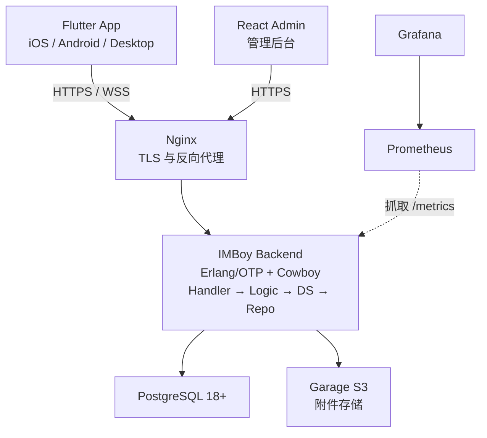

<p align="center">
  
</p>

# IMBoy 后端

[English](./README.en.md)

IMBoy 是可私有部署的即时通讯平台。本仓库包含 Erlang/OTP 后端、数据库迁移、生产部署配置和产品文档；Flutter 客户端与 React 管理后台在独立仓库中。

## 能做什么

一期交付（`phase1_delivery` profile）能力面：

- 单聊、群聊与消息推送（Core IM：联系人、历史/离线/多端同步、附件与消息治理）
- 已登录 App 好友之间的一对一语音/视频（`rtc` 已选入编译清单，运行时预设默认允许，可通过 `features.rtc=false` 显式关闭）
- 企业组织/部门/成员/工作区与 RBAC；人工客服坐席与访客 Widget；OA 对接（internal API / SSO / Webhook）
- 频道底座（组织内部 General 群与公告频道）
- 朋友圈与附近的人（一期范围；发布、互动、定位及隐私控制须按交付矩阵验收）
- HTTP API 与 WebSocket 长连接
- PostgreSQL 持久化与 Garage S3 附件直传
- Docker Compose 单节点生产部署（Helm/Kubernetes 为实验性，未经生产集群验证）

仓库还保留频道发现/邀请/付费频道、E2EE 端到端加密、群通话（`rtc_group`）、Bot、AI 助手等域，是否编入以目标 manifest 为准；一期交付 profile 下这些域经交付锁与 fail-closed 门禁关闭，旧缓存或远端配置不能重新打开。分期边界、白名单与交付锁清单见[打包契约](./docs/product/packaging-contract.md)，交付包内容见[交付包清单](./docs/product/delivery-package-manifest.md)。

RTC 的编译包含、运行时允许与真实双端音视频验收须分别核对；manifest 的 profile 不会自动切换现场运行时 profile。访客、Web 坐席及 C2S 音视频不在本次开放范围，群通话仍未选入且受交付锁关闭。边界与验收要求见[打包契约 §9.5](./docs/product/packaging-contract.md#95-app-一对一-rtc-与群通话边界)。

## 系统架构



## 本地启动

准备 Docker 24+、Compose v2.23.1+、Bash 与 OpenSSL，在仓库根目录执行：

```bash
test -f .env || cp .env.example .env  # 保留已有配置
${EDITOR:-vi} .env    # 填写 dev / pro 两个数据库密码
bash scripts/dev_setup.sh
```

默认启动 PostgreSQL、Garage、API、Admin 和 Nginx（含附件下载边缘服务）。访问
[API](http://api.localhost:8080/api/v1/init) 与[管理后台](http://admin.localhost:8080)。
新数据库先打开 [/setup](http://admin.localhost:8080/setup) 创建首个超级管理员；已有实例使用原账号登录。
LiveKit 与 Widget 按需启用；本地栈不启动监控组件。首次构建与拉取镜像的耗时取决于网络和机器性能；镜像准备好后可重复快速启动。

```bash
bash scripts/dev_setup.sh --with-livekit --with-widget
```

后端源码调试使用 `bash scripts/dev_setup.sh --infra-only`，再按指南构建并启动宿主节点。
配置、profiles、数据保留与手机联调见
[本地开发指南](./docs/guides/operations/deployment/local-development.md)。

## 常用命令

```bash
make compile                         # 编译
IMBOYENV=local make run              # 启动本地服务
make eunit                           # 单元测试
make eunit-local                     # 使用本地 PostgreSQL 跑测试
make dialyze                         # 类型检查
make ctl ARGS="node status"          # 查看节点状态
make ctl ARGS="db ping"              # 检查数据库
```

## 代码入口

```text
src/api/       HTTP / WebSocket 参数处理
src/adm/       管理后台接口
src/logic/     业务逻辑
src/ds/        数据服务与缓存
src/repo/      PostgreSQL 访问
src/lib/       通用基础能力
priv/          数据库迁移与静态资源
deploy/        生产部署
docs/          架构、协议与运维文档
```

业务调用遵循 `Handler → Logic → DS → Repo`。新增接口通常需要修改 Handler、路由、Logic，并补测试；不要修改 vendored 的 `erlang.mk`。

## 生产部署

商务部署使用单独交付的 Compose 配置。获取配置后，按[部署说明](./deploy/README.md)运行安装器。

## 继续阅读

- [**在线文档站**](https://imboy-pub.github.io/imboy/)（教程 / 指南 / 参考 / 合规）
- [核心业务概念](./docs/concepts/README.md)（账号 / 组织与工作区 / 消息 / E2EE / 智能体 / 客服 / 企业业务）
- [术语表](./docs/glossary.md)（三端统一的正式名称与易混裁定）
- [E2EE 协议规范](./docs/reference/e2ee-protocol-specification.md)
- [本地开发指南](./docs/guides/operations/deployment/local-development.md)
- [后端架构](./docs/architecture/overview.md)
- [REST API 目录](./docs/reference/rest-api-v1-catalog.md)
- [WebSocket 协议](./docs/reference/ws-protocol-contract.md)
- [贡献指南](./CONTRIBUTING.md)
- [安全说明](./SECURITY.md)

## 许可证

**Business Source License 1.1（BSL 1.1）** —— 源码公开，四年后自动转为 MPL 2.0。

- **可以**：复制、修改、再分发；非生产用途免费；生产环境中的组织内部使用、单客户私有部署、集成进自有产品，均在 [LICENSE](./LICENSE) 的 Additional Use Grant 范围内免费。
- **需要商业授权**：向第三方提供多租户托管服务（SaaS），或提供与官方付费版竞争的付费产品或服务。

本工作区包含三个可独立发布的子项目，三者许可并不相同：

| 项目 | 许可证 | 简单理解 |
|------|--------|----------|
| `imboy`（后端，本仓） | BSL 1.1 | 源码公开，但限制竞争性商业使用 |
| `imboy-admin-frontend`（管理后台） | BSL 1.1 | 源码公开，但限制竞争性商业使用 |
| `imboy-flutter`（移动客户端） | 木兰宽松许可证第 2 版（MulanPSL-2.0） | 真正意义上的开源 |

2026-09-14 之前发布的版本按[木兰宽松许可证第 2 版](./docs/legal/MulanPSL-2.0.txt)授权，不受本次变更影响；该文件作为历史授权文本保留。

商业授权、白标与商标使用请联系维护者。完整说明见 [docs/legal/licensing.md](./docs/legal/licensing.md)。
