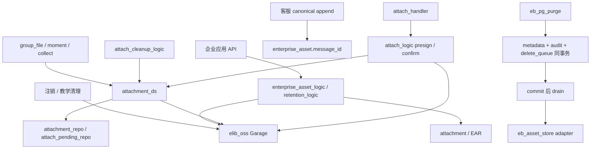

# IMBoy 附件生命周期 V5：真实现状与差距 / Source audit

日期：2026-10-09（Asia/Shanghai）。范围：只设计、取证与评审；未实施业务代码或新迁移。
本报告按 FACT → GAP → DECISION → CONTRACT → TASK → TEST → EVIDENCE 串联，后四项见主计划、迁移合同、任务和状态合同。

## FACT：候选与证据边界

| 仓库 | 分支 | HEAD |
|---|---|---|
| imboy | main | 9c719d264130cdb76c94e3020981615bc7229111 |
| imboyapp | main | 0d941418ad17d1d8aa16b7d1430633b85f886a9a |
| imboyadmin | main | 62c40f27ba498049dd911e9f7d4e9d1929620c66 |

三个工作树均不应视为干净候选。逐路径状态与已跟踪差异哈希见 `evidence/baseline.json`。
App 有既有 i18n、WebView、企业工作台和已暂存平台依赖变更；Admin 有客服 Seat WIP；后端有商业/设计文档 WIP，取证中又出现客服测试文件。全部归外部工作，不纳入本次提交，也不以 HEAD 替代实际工作树证据。
后端最大迁移 00000165，当前共 164 个 Up（41 缺号）；每个 Up/Down 哈希见 `migration-hashes.txt`。Flutter迁移真源 `lib/service/migrations/manifest_all.dart`，最新edge `upgrade_edges_v32.dart`（31→32）；Admin 无 PostgreSQL 迁移所有权。

真实重建：现有本地容器 `imboy_phase1_pg_d3b19db3_repro`，新建专用库 `imboy_lifecycle_v5_20261009`，PostgreSQL 18.1。按文件名逐个在事务中执行原始 Up SQL，全部 exit=0；不是 erlang_migrate ledger 验收。扩展及执行日志、完整空库 schema、catalog 查询/结果已保存。不读取现有业务库记录，不含生产 PII。三个合成 SQL 探针全部完成并 ROLLBACK，剩余合成附件 0。

## FACT → GAP：逐项证据

| ID | FACT（当前文件/位置） | GAP / 判断 | 后续 |
|---|---|---|---|
| F01 | `src/logic/attach_logic.erl:63` 先签 URL，pending_add 错误/异常只记录，仍返回 ok | 登记失败继续授权上传，P0；代码确定，尚未 HTTP 故障复现 | W2-01 |
| F02 | `src/repo/attach_pending_repo.erl:35` conflict 更新 bucket/scope/creator；catalog 无身份触发器 | Pending 身份可变；合成 SQL 已验证（不等同外部越权 exploit） | W1-02,W2-01 |
| F03 | `attach_logic.erl:124` 只验 key owner，HEAD 桶取请求 Scope；不是读取 pending location | 不能保证 scope/location 与签发时一致 | W2-02 |
| F04 | `attachment_repo.erl:121` path 冲突递增 referer_time；DS save_confirmed_tx 只使首条审计幂等 | Confirm 重试不等于引用幂等；真实 PG 同式 upsert 得到 2 | W2-02 |
| F05 | `attach_pending_repo.erl:list_expired/1` 有 NOT EXISTS attachment；`attachment_ds.erl:185` 随后外部 DELETE | 残留 pending 静态防护已存在，但选择后 Confirm 的竞态未被锁住，不能关闭误删风险 | W2-03,W4-01 |
| F06 | `attachment_ds.erl:138` orphan 先存储 DELETE，再 DB DELETE；`attachment_repo.erl:367` 仅 referer_time=0/status/年龄，无引用/hold锁 | 默认桶、引用竞态、DB 失败后对象丢失 | W3-01,W4-01 |
| F07 | `enterprise_asset_retention_logic.erl:251` 治理事务内删对象；`delete_object/1` 未识别结果兜底 ok | 对象已删后事务/audit失败无法回滚对象；不接受注释所称“绝无半成品” | W3-02,W4-01 |
| F08 | `eb_pg_purge.erl:154,177,379` 同事务 intent/metadata/audit，提交后 drain；00000163 已建队列 | 此结构性风险已修复（SOURCE_CONFIRMED）；不得新建平行 GC。真实 Garage/崩溃验收未做 | W4-02 扩展既有队列 |
| F09 | `eb_pg_asset_meta.erl:209` workspace锁 + pending CAS + pending_object_delete；00000162 持久标记 | 不重复发明 pending claim；但与 queue 是两个现存删除通道，应汇入同一 worker | W4-02 |
| F10 | `eb_pg_asset_delete_queue.erl:27` 普通 SELECT，无 claim/lease/backoff；仅 key，按当前 object_store 配置删除 | 多 Worker 重复工作、毒任务饥饿、配置漂移、结果无审计终态 | W1-02,W4-02 |
| F11 | `eb_asset_store.erl:137` delete_private 直删对象；`attach_logic.erl:155,160,171` 内容拒绝直接删；`enterprise_asset_logic.erl:167` 同类 | 隐藏删除入口必须一起收口；API 未暴露也不能认定安全 | W4-01 |
| F12 | `user_deletion_executor.erl:41` 按创建者删全部 attachment；`user_deletion_logic.erl:297` 事务后 best effort；`moya_attach_logic.erl:170` 未绑定教学先删对象 | 创建者不等于唯一业务所有者；账号注销/教学清理必须走共同资格及持久任务 | W3-01,W4-01 |
| F13 | `group_file_ds.erl:80,121,293` 已登记 pending、同事务附件+群文件；00000108/157 已有 group_file_id/查询索引 | 复用已有锚点，catalog 无 group_file_id FK；不能仅由列非空断言全量引用 | W3-01 |
| F14 | `moment_ds.erl:65` 同事务 bind_moment_scope_ref；moment_post.media JSONB；channel_message payload；user_collect.info 和 attach_file_hash256 | 关系并非统一 attachment FK，hash不是对象身份；密文与历史 URL 不能据搜索结果“无引用” | W0-02,W3-01 |
| F15 | 客服 `cs_session_app.erl:706` 将 asset_ids 传企业 append，`eb_pg_store.erl:359` 锁资产绑定 | 客服复用 enterprise_asset，禁止新客服 GC/引用表；保留租户/消息幂等 | W3-03 |
| F16 | `imboyapp/lib/store/api/attachment_api.dart:161` presign→PUT→confirm 单次编排，返回 key；PUT重试已有 | 未证明进程重启后恢复已上传未确认状态；不得称其没有任何重试 | W5-01 |
| F17 | Admin widget `attachmentMachine.ts` 已有 pending/confirming/sending/linked/failed，clientMsgId保持 | 复用，不重造 UI 状态机；Seat 文件当前有外部 WIP | W5-02 |
| F18 | `docs/adr/0008-pluggable-attachment-storage.md` Status=Proposed；代码仍 elib_oss、未发现 driver 实现；ADR关联历史计划文件当前缺失 | Garage/Disk抽象只是提案；本V5不用历史计划冒充已实施。不得 scope 推断批量回填旧位置 | W1-01,W4-03 |

## FACT：重建 Schema

`evidence/catalog.txt` 是实际数据库 catalog；`reconstructed-schema.sql` 是合成空库 pg_dump，不是生产快照。

- attachment：path UNIQUE；status ∈ {-1,0,1}；cipher、scope/ref、group anchor 已存在；没有 storage_driver/location、生命周期列或引用真实性约束。普通行 path/creator UPDATE 可成功，探针已回滚。
- attach_pending：object_key PK、bucket 非空默认空串、scope/creator/created_at；created_at 索引；无状态、expiry、lease、immutable 触发器。
- enterprise_asset：独立租户键、status、message_id、retain_until、version、pending_object_delete；既有保留/删除触发器与企业消息关系必须保留。
- enterprise_asset_delete_queue：PK(org,workspace,asset_id)、object_key、created_at；FK workspace ON DELETE RESTRICT；并非普通附件可直接无改动使用的表。
- enterprise_attachment_retention：attachment_id PK/FK RESTRICT，企业应用域附件的 retention/hold/purge 账本，禁止删除，留存只延长，purged不可回退。它与 enterprise_retention_hold 是不同主体，不能机械合表。
- enterprise_retention_hold/policy：企业消息域；已有 active hold scope守卫。复用既有 workspace锁，补齐运行期与 direct DML 防线，不替换 domain 判据。
- 引用 FK、索引及触发器全量定义见 catalog；不得把 column COMMENT 当成不可变约束。00000108 的 “immutable after insert” 注释不构成 DB守卫。

## TEST → EVIDENCE：本轮结论边界

`schema-rebuild.log`：164 个原始 Up 全部提交；迁移器版本台账、升级旧库、Down、生产历史样本仍 UNVERIFIED。
`baseline-probes.log`：3 个观察性断言成功（不是修复PASS），覆盖计数+1、pending身份改写、普通附件身份无DB守卫。
`pending-eunit.log`：`make eunit t=attach_pending_cleanup_tests` exit=2，missing_config/pg_conf导致3个setup取消，executed=0，PASS=0；不是通过。该套件即使通过也只是mock，不证明竞态安全或Garage。
存量测试 `eb_purge_orphan_asset_pg_tests.erl:29` 主动选择 asset_stub，注释“真实对象字节”不能当 Garage 验收。已有测试文件只能证明测试存在；无绑定当前候选的原始输出，不继承历史PASS。
真实 Garage HTTP删除、真实Disk、Flutter真机、Admin浏览器、进程崩溃/数据库故障、本地业务历史分布：本轮 UNVERIFIED。W6逐项补齐，无法获得条件则 BLOCKED_EXTERNAL，绝不自动跳过。

## DECISION：复用优先

保留两类业务元数据和两类治理主体；扩展 enterprise_asset_delete_queue 为唯一持久物理删除工作队列，保持现有表名以减少搬迁；pending_object_delete转接适配器保留一轮升级兼容。普通引用优先读现有关系，无法证明的范围不自动GC；本V5不建通用附件引用总账，不以 hash/URL猜测建立“已验证”归属。
Storage Boundary复用ADR方向但不复制其不安全历史回填假设；本V5新增 location namespace以区分相同driver不同实例。未知位置保留历史读取兼容适配，但禁止删除和自动回填。

## 结束前重新取证：外部 Flutter 改动

HEAD 未改变，但 Flutter 工作树在本轮发生外部变动：attachment_api.dart 新增 image/jpg 到 image/jpeg 归一；attachment_handler.dart 新增视频响应形状、时长处理和日志变更，相关测试也有改动。已只读核对，不纳入本次提交，不覆盖。F16 的上传编排及缺少持久恢复结论未被这些差异推翻；最新相关文件 hash 见 refreshed-source-hashes.txt。

final-source-status.json 记录结束前状态；source-drift-check.json 保留初始取证后的漂移，不重写为从未变化。W5 路径与外部 WIP 重叠，执行时必须 W0 重绑定并解决所有权；未解决为 BLOCKED_EXTERNAL，不自动接管。

环境要求的 /mem load 没有可用 mem 可执行入口，旧 ~/.Codex/memory 无 core.md 可读。本轮只读现有 memory registry 定位历史线索，再按当前源码复核，没有写记忆文件。

## 当前调用图

图表示现有关系，不代表符合 V5 锁序。V5 要求物理删除最终仅从提交后的统一 worker 进入 driver。
