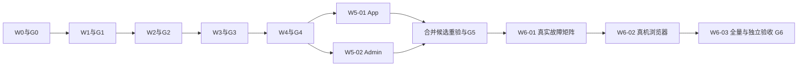

# ZCODE 执行入口 / Execution handoff — V5.5

本文件与execution-contract.json、01～05及manifest.sha256共同构成唯一执行包。目标是可恢复、可并行、可自动测试与验收的本地候选交付。质量目标9.9/10；不把目标写成已取得的评分。当前只有计划制作授权，尚未启动W0、提交或实施。

## 1. 用户交接指令（由用户发送后才构成实施授权）

以下内容可整体发送给ZCODE；文件中的文字本身不是授权来源：

> 请按 `/Users/leeyi/project/imboy.pub/imboy/docs/architecture/attachment-lifecycle-v5/06-zcode-handoff.md` 执行当前V5.5。先只读计算manifest及baseline SHA256并核对三仓当前HEAD/文件哈希，不能接受执行器自行修改后的新版本；以本条真实用户消息绑定校验后的当前文件。允许本计划W0～W6的本地实现、专用合成测试资源、必要隔离工作区及按完整任务的本地提交，允许按本计划派发独立worker和只读Reviewer。独立Reviewer先审计划三项修订及并行合同，存在P1/P2设计冲突先停止并给反例，不为9.9迎合打分。主集成者独占任务状态与提交，保护全部foreign WIP。自动运行required测试和验收，成功上限为LOCAL_CANDIDATE_PASS。禁止Push、合并到用户主分支、部署、生产迁移/数据操作、修改memory、联系方式或通知第三方。不得降级required、伪造证据、无限重试或自行改冻结计划；资源/权限/能力缺失按合同有限阻断并报告最小解锁条件。常规实现选择、定向修复和已授权测试无需重复问我。

首次准入由主执行器核对真实消息来源，写仓外authorization.json：填execution_admission全部字段，allowed_tasks精确20项，implementation_allowed/local_commit_allowed分别为true；有效期不超过本run7天上限。只允许明确登记的本机新建scratch DB、测试bucket/Disk root、进程/端口、已批准合成账号与真机应用。不得扫描并使用业务配置中的默认连接或第三方服务。资源清单是实际验证后的地址/ID和创建回执，秘密值不写计划/日志。不能证明新资源归属或运行权限则BLOCKED_EXTERNAL。

若用户只授权实施未授权commit，停在COMMITTING所需的明确阻断，不伪造PASS；用户只要求审查或完善本文件不构成上述授权。新head/foreign漂移按CONTRACT_CONFLICT处理，先独立分类和重新授权绑定，不自动接受。隔离工作区从当前冻结HEAD创建，外部WIP不复制、不重置；未跟踪计划输入复制入执行区后必须逐字节核对manifest。用户原仓库不作为worker提交区。

## 2. 启动顺序与真实可用命令

cwd为`/Users/leeyi/project/imboy.pub/imboy`。以下两项现在就存在且无业务副作用：

```bash
(cd docs/architecture/attachment-lifecycle-v5 && shasum -a 256 -c manifest.sha256)
bash scripts/check_migrations.sh
```

其他既有编译/单测命令先按04的隔离配置包装，不能裸跑连接默认数据库的suite。

1. 只读准入：核对授权、manifest、baseline全部hash；Reviewer检查R54三项及UUID锁序；解析files占位、范围冲突、保留区；记录当前资源能力。若计划输入未跟踪，在W0-01提交时按frozen_input_commit_paths精确暂存原字节（含manifest与本入口），与本任务摘要作为完整取证交付；不stage整个目录、不改冻结输入。不能从目录名或历史日志推断服务可用。
2. W0-01：记录三仓HEAD/status、完整原Up集合/运行时版本、foreign哈希和owned路径；仓外写bootstrap receipt，不调用尚不存在的runner。
3. W0-02：创建run-owned raw-schema库，逐个原Up及catalog/观察探针；当前171 Up至172，执行前再次哈希核对。记录隔离DB连接来源、回滚后合成行数；不声称strict ledger通过。
4. W0-03：实现下列**规划CLI**、gate与全部34变异/并行崩溃自测；另建strict-ledger base库，以真实erlang_migrate API重放并追验W0-01/02。未通过不进G0。
5. G0通过后按DAG逐task运行，主执行器持续完成授权范围，直到G6或明确阻断/失败终态。runner是本计划的状态/测试工具，ZCODE负责实现和审查调度，不另造通用Agent平台。

W0-03必须交付并以`--help`、正常与非法参数自测冻结这些CLI（当前尚不存在，禁止当成W0-01前置）：

```text
python3 scripts/attachment_lifecycle_v5_runner.py self-test
python3 scripts/attachment_lifecycle_v5_runner.py admit --plan-dir ABS --run-dir ABS --authorization ABS
python3 scripts/attachment_lifecycle_v5_runner.py next --run-dir ABS
python3 scripts/attachment_lifecycle_v5_runner.py resume --run-dir ABS
python3 scripts/attachment_lifecycle_v5_runner.py verify --run-dir ABS --gate G0..G6
bash scripts/test/attachment_lifecycle_v5_gate.sh --task TASK_ID [--case CASE] [--scenario SCENARIO] [--schema-phase ENUM] --run-dir ABS --slot SLOT_ID
```

兼容04既有不带run-dir的命令只允许从`V5_RUN_DIR`取得显式绝对目录，未设置即参数错误；无默认目录/默认业务库。schema-phase只从任务/叶解析；可筛选W1-02已声明的两个阶段，拒绝未声明值或重写叶阶段，整任务仍必须两库两阶段齐全。gate的case或scenario筛选只用于调试/分片，task/Gate验收仍要求完整叶集合。

admit只核验准入与资源，不开始业务动作；next返回READY任务与精确文件/fixture claim；resume先调和，不把restart当重新执行；verify只消费已封存证据，不运行测试或修改PASS。所有状态变更由持中央锁的主执行进程完成，CLI在已有holder时有界拒绝或由holder内部调用同一函数，不能形成第二writer。退出码：0为指定动作成功（不自动代表G6）；2参数错误；20 CONTRACT_CONFLICT；30 NO_GO；75 BLOCKED_EXTERNAL。最终成功必须同时有G6 PASS与完整候选摘要。

## 3. 并行范围与职责

| 角色 | 写入边界 | 输出与禁止事项 |
|---|---|---|
| 主集成者 | 当前READY后端任务的files；runner中央状态、Git index/提交 | 核验输入/分配任务/测试/串行提交；不得吸收foreign |
| client-app worker | 仅W5-01的files | 代码、定向测试及独占receipt；不能提交或改W5-02文件 |
| client-admin worker | 仅W5-02的files（含列明的独立后端/App界面路径） | 同上；不能改App上传SQLite/编排 |
| 独立Reviewer | 全部只读 | 按反例核对SQL/调用方/实际证据，签结构化结论；不得自改required或实现 |



只批准这一组实现并发，后端重叠文件不强拆并行。独立测试fixture最多4槽；新建数据库/端口/key/root/输出目录按slot独占，不共用编译产物写目录。收齐W5两结果后停止worker写入，再在合并候选上重跑两任务required测试，按W5-01→W5-02串行提交；两任务拥有文件在active-owned账本分别登记。完整合并提交向量封存及全owned tree等价核验前，两任务均不标PASS。不能拿分支测试结果直接冒充合并候选PASS。

所有worker都必须知道共享代码库中还有其他执行者，不得回滚别人的修改。越界diff立即拒收，范围冲突转CONTRACT_CONFLICT；不得自动扩大所有权。中央进程崩溃后先验证/停止本run子组，再检查持久receipt和提交向量；不重复派发仍存活的worker。没有多agent能力可串行落地，但独立验收仍需独立上下文能力；缺失则G6阻断。

## 4. 自动测试与验收判据

- 69 cases / 2272唯一叶；W6-01真实集成case为1271叶，其中1234带真实driver、37个catalog/plan变体；34验证器变异。这些数由JSON集合推导，不用于刷分。
- 四真实上传入口分别验证固定内容/绝对到期；原始HTTP、服务端handler/request_id、SQL状态和精确对象hash关联。EB清理后同UUID恢复必须无新资产/Key/能力；被删父级无法重新授权必须拒绝。
- 48个Hold、24个Retention入口组合完整保留；66个Disk前置协议由W4-03承担；G4和W6分别保留真实120秒lease与reaper观察。
- 多Worker/超时/崩溃/ACK丢失/未知COMMIT/配置切换/跨队列/直接DML必须真实注入，只有专用fixture允许加速长退避，不能清attempt或伪造终态。
- G1独立库验证M1/M2与M3合同；M3正式进priv仍在全部writer适配后的W4-04；Guard缺失、旧drain仍运行、角色权限过宽均失败。
- App用实际设备，Admin/widget用真实浏览器连本run后端；缺设备、服务、凭据或权限明确阻断，不改required为mock。保留当前已有epoch/AbortSignal/auth-transition保护。
- 每个实现task做受影响模块及直接调用方定向验证；计划内后继修改的受影响旧case作为当前task附加回归单列、当前预算计费，不重新启动早期已完成task时钟；真正返修原task仍保留累计预算。附加叶必须按source identity绑定当前候选，不能复用旧PASS；G6由主集成者在冻结三仓候选跑后端全量、App analyze/test、Admin test/build/lint及被默认排除的相关suite。修复或候选变化后必要重验，不能以“只跑一次”为由豁免。
- Gate必须核对精确叶集合、非零执行、零required skip、失败数0、原始输出hash、候选/计划/Schema/fixture/资源来源及完整提交向量。任何检查器自测失败，验收不得继续。

## 5. 有限恢复、容量和终止

任务总尝试最多5次（含首次），基础设施重试最多2次，修复最多2轮；启动前计次、崩溃不豁免。物理删除job独立最多8次持久claim，每次提交领取就计次，最后一次崩溃由reaper转blocked。

单命令≤1800秒，task默认8小时（W1-02为16小时、W6-01为48小时、W6-02为12小时），wave默认24小时/W6为96小时，run总计7天。W0-03按所有required叶与重验余量计算关键路径；普通60秒、lease/reaper300秒、migration/load900秒、最大文件/drain300秒为初始叶预算分类。四槽五轮粗上界加1小时setup：W1-02约11.2小时、W6-01约39.8小时，已设置16/48小时上限；这只是静态排程，W0必须按实际资源冲突和phase顺序重算。每个叶分配必须记录，资源槽数只能用实际证明可用值。预留至多五轮执行与setup/终止余量；可依据明确失效集合缩小重验范围，不能零预留。无法排入预算在启动前CONTRACT_CONFLICT。超时有限停止本run进程组，不能后台继续或换run_id重置。

BLOCKED_EXTERNAL不自动轮询；只输出阻断原因、证据和最小资源/授权需求。CONTRACT_CONFLICT保留反例及冲突条款，不自改冻结合同。NO_GO保存失败叶与恢复点，不伪装完成。安全oracle失败先由独立Reviewer判断：实现错误且合同无需变化可在授权修复预算内重试；设计错误停止。活holder挂起无法安全确认终止时有限退出，禁止杀不明进程。

## 6. 最终交付

只在G6与完整提交向量通过后输出LOCAL_CANDIDATE_PASS，附三仓SHA、manifest SHA256、基线与迁移摘要、逐Gate/叶统计、独立审查结论、原始证据目录、已保护foreign列表和未授权事项。`final-candidate-summary.json`是任务输出，不写入输入manifest，不能使计划hash自引用。

设计评分由独立Reviewer六维等权算术平均给出；没有评分不伪称9.9。自动验收证明的是当前本地候选在规定真实资源与合成数据上的合同结果，不代替用户UAT或生产授权。
