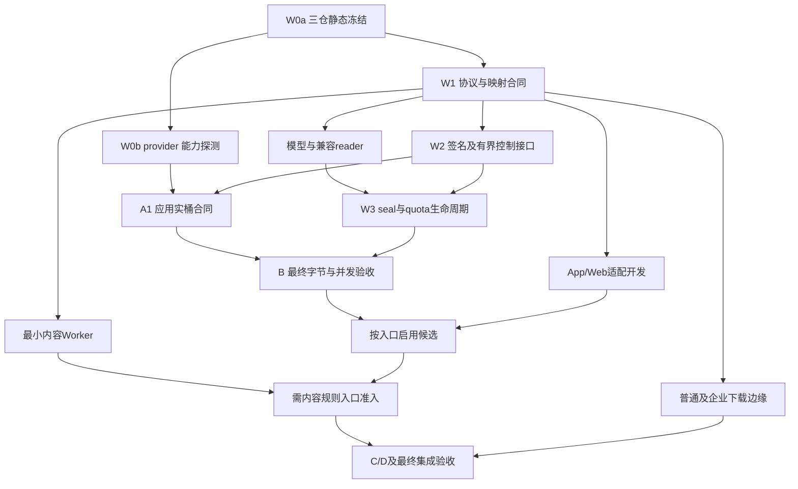

# IMBoy 附件 S3 直传改造计划 V2.2

日期：2026-10-19（Asia/Shanghai）  
状态：`DESIGN_REVIEWED / IMPLEMENTATION_NOT_EXECUTED / ACCEPTANCE_NOT_RUN`。本轮仅做文档与源码静态核验，没有实施产品变更、运行业务测试或验证真实存储。  
目标：在保留附件生命周期与各认证面业务合同的条件下，使启用新协议的 S3 上传、确认、下载及内容处理正文退出 BEAM；不把“客户端发了 PUT”当作完成。

## 1. 审查结论与版本取舍

**V2.1 可以继续作为安全设计输入，但尚不足以直接按 W0'→W9' 线性执行。** 必须修正真实调用链、逻辑引用与物理位置的模型、客户端全链内存、下载任务归属及阶段依赖。V2.2 保留 staging→sealed、最终字节证明、单次写 attempt、winner/GC 互斥等设计，补齐可交付的工作包，不另造附件系统。

| 版本 | 应保留 | 主要局限 | 处置 |
|---|---|---|---|
| V1 | I01–I14、T01–T50、全入口意识、Disk/MPU/迁移边界 | 基线较早；部分问题后来已修；实际 pin 早于最终对象稳定性验证 | 作为需求与测试来源，不能直接执行 |
| V2 | 识别 V5 控制面复用、G01–G14、并行写集边界 | 普通 confirm 全量 GET 漏列；高估客户端流式能力；Seat 凭据判断不完整；继承引用过多 | 保留差距编号，逐项重新取证 |
| V2.1 | 同字节裁决、target_write_closed、未知副作用隔离、GC claim、量化性能框架 | W0/Gate A/W2 存在依赖环；下载与映射工作包不足；云环境快照不适用于当前 Mac；仍有错误现状判断 | 修正后收敛为本版；不以文档评分代表验收 |

### 1.1 会影响实施正确性的审查发现

| ID | 等级 | 静态证据（Backend 路径相对 imboy；其他带仓名） | 影响与本版修正 |
|---|---|---|---|
| R01 | P0 | `src/logic/attach_logic.erl:332` 的 `verify_and_save_v5`→`:351` `v5_object_bytes`→`attachment_storage_garage:read_snapshot`；后者在 `src/lib/attachment_storage/attachment_storage_garage.erl:18` 用 httpc 接完整 binary | 只改 elib_oss HEAD 仍会在 confirm 全量读文件。新协议必须单独分派到最终 proof 路径；旧 V5 行为保留到排空 |
| R02 | P0 | `attachment_storage_garage.erl:92` 的 head 直接 read 全对象；`attachment_storage_driver.erl:16` head 合同只有 size/type；`elib_oss.erl:360` 另有 GET+Range | 存在两个不同的伪 HEAD，不可只修一个。新增控制接口需贯通真实 driver 与调用者，禁止以 legacy read 作 fallback |
| R03 | P0 | `attachment_storage.erl:167` 的 snapshot 将传入 Key 直接设为物理 `key`；`attach_logic.erl:928` 的 sign_view、`eb_pg_asset_delete_queue.erl:53` 的删除同样传逻辑 key | 当前冻结位置不等于已有逻辑 key→新 candidate key 映射。必须交付映射、reader、delete intent 捕获及所有直接 key 消费者，否则会确认成功却下载/清理错误对象 |
| R04 | P1 | imboyapp `resumable_attachment_uploader.dart:719,:755` 恢复 readAsBytes，`:917` 向现有 API 传 bytes；`attachment_api.dart:558,:708,:822,:982,:997,:1107` 读取/上传整文件；`attachment_encryptor.dart:35` 返回完整 ciphertext | 写盘提供恢复能力，没有实现端到端有界内存。拆为文件 source→hash→加密文件→传输→恢复→下载验证完整链；既有 Uint8List 仅保留明确限额的小对象兼容 |
| R05 | P1 | imboyadmin `customer_service/seat/seatApiClient.ts:263` 对同源业务 upload_ref PUT 加 Seat Bearer；imboyapp `cs_asset_put_transport.dart:45` putMember 同样携认证头，`:105` putObject 才是无业务认证对象上传 | V2/V2.1“Seat/Widget 均为干净 PUT”不能概括现状。现有同源认证分支是业务合同，保留；新 descriptor 显式区分 business_gateway 与 s3_put，绝不按 URL 特征误发凭据 |
| R06 | P1 | `attach_logic.erl:928` Garage sign_view 签短 GET；App `asset_url_resolver.dart:45` 缓存 URL 540 秒 | 逐次撤权不能只改 view_url；已发 S3 URL 无法靠再次申请检查撤销。普通 group/channel/moment 的下载边缘化须有独立工作包；历史 URL 也需要到期排空 |
| R07 | P1 | V2.1 §13：W0 完成要求 Gate A；Gate A 又要求签名强绑定与 Copy；相应新代码在 W2/W3 | 拆 A0 provider 探测与 A1 应用集成。A0 缺资源只阻塞真实合同与启用，不阻塞独立协议、代码和 mock 控制流开发 |
| R08 | P1 | V2.1 把 register 视作无写能力的既有基础；当前 `attach_logic.erl:164,:184` 对 registered 会话构造 capability/put_url | direct register 必须新版本无写能力；不得复用旧 operation 后悄悄删字段，也不得把当前实现描述成已经 reserve/grant 分离 |
| R09 | P1 | V2.1 §13 要求每功能 commit；本任务和各仓 AGENTS 要求明确授权才可 commit | 工作包是评审/验证单元，不自动成为提交授权。实现、提交、合并、push、第三方通知、部署分别遵守当时授权 |
| R10 | P2 | V2.1 §23 是另一个 Linux 云环境快照；本轮 cwd 是本地 Mac；组织定位 ADR 已明确 organization 为业务对象 | 移除云工具可用性假定，采用运行前探测；“跨租户”改为跨实例/跨主体/跨应用权限用例，组织归属不替代授权 |

以上是规划风险分级，不是已验证的线上漏洞报告。未执行真实调用、性能或攻击测试。

## 2. 本轮冻结基线与证据边界

| 仓库 | 初始审查 HEAD | 交付复核 HEAD | 本轮工作区观察 |
|---|---|---|---|
| Backend `imboy` | `f2512df72dd9aace89c68594ef283381668b6735` | `a2fe60cd3d1883ed4392969485c151a7861b4937` | 外部未跟踪文档/目录与迁移 hash 文件保留；初始未跟踪的 `src/textguard_pb.erl` 已随并行提交纳入跟踪，本任务未修改或提交它 |
| Flutter `imboyapp` | `c015d101171232e8dc9a3422750368a8e023ea9e` | `c61cd8d46e276496b2ddae8b89b17d6fe6856ddc` | 初始及交付复核 git status 均为空；保护 ios/macOS/plugin 保留区 |
| Admin `imboyadmin` | `cd75c1aa868ce8c591ffd70009ba3e940f892453` | `74af973f7d444c8e108a88d6696e7fc8605c8406` | 未跟踪 `zcode-resume-prompt-v5.md` 属外部 WIP；两次 HEAD 的文件树无差异 |
| 补充 Moya | `1f0faab6d76c26aa507710d83df64659f1378ab0` | 未再次核验 | 本地仓可见，README/发布文档有修改及新文档；本轮仅核对身份和初始状态，没有重新审阅其上传实现 |

交付复核发现三仓并行 HEAD 漂移，已逐仓核对初始 SHA 到复核 SHA 的文件差异：Backend 涉及频道统计、Admin 频道鉴权、OA SSO、生成协议与相关测试；Flutter 涉及生成 provider 与测试目录；Admin 文件树无差异。本版关键附件源码及调用链未在该差异中变化。另核对 `adm_acl:ensure_permission/3` 仍保留 HTTP 200 信封默认值，新 `/4` 仅允许端点显式选择 403，不改变本版逐认证面冻结错误合同的要求。该静态差异复核不继承这些并行提交的测试结论。

主范围是用户要求的 Backend/App/Admin 三仓。Moya 独立扩展包不阻塞三端已隔离范围；未完成时不能宣称所有入口均退出 BEAM。

输入文件位于 `/Users/leeyi/Downloads/`，完整性如下：

| 文件 | SHA-256 |
|---|---|
| IMBoy_S3_Direct_Transfer_Refactor_Plan_V1.md | `a1a762f29168a612c689691e5b37735a842c1b65fbcc2d054d01d7c839420b6c` |
| IMBoy_S3_Direct_Transfer_Refactor_Plan_V2.md | `f47ed296c0064463eaff0b55d07bd4e48d0b2205e0c30781dcaafd4ded087fd5` |
| IMBoy_S3_Direct_Transfer_Refactor_Plan_V2.1.md | `f3eca4ddf25e546851e205c7635ecc60b06c29dbb60f824b8f94d494c1d44bed` |

当前已见最高迁移编号为 00000198，**不预分配下一号**；实施前检查最新 main、在途迁移和预约机制。源码证据依附上表初始 SHA 与交付差异复核，不自动适用于未来候选。

现行依据：各仓 AGENTS/CLAUDE、`docs/adr/0008-pluggable-attachment-storage.md`、`docs/architecture/attachment-lifecycle-v5/`、`docs/architecture/2026-10-12-organization-positioning-amendment.md`。生命周期语义与新直传冲突时先记录明确修订，不能用“复用 V5”隐藏 pin 时点改变。

本轮只验证静态实现存在及调用关系；V5 历史测试结果、四仓远端一致性、运行中 Garage/权限/反代、真机/浏览器、全量门禁和生产状态均未重新验证。V2.1 的官方资料结论只作待复核输入；本版不新增未经查证的 provider 支持承诺。

## 3. 范围、复用与差距登记

保留现有会话幂等、capability、流式 spool、受限 pin 函数、存储 namespace/digest、生命周期 intent/worker、App journal 和 Web credential epoch。它们是复用起点，**不是 direct 协议、配额或完整验收已经完成的证明**。

| G ID | 当前判断 | 本版交付归属 |
|---|---|---|
| G01 | host-only presign，未绑定 checksum headers | W2 / step-5 |
| G02 | elib_oss GET+Range；还需覆盖 R02 driver 全读 | W2 / step-5 |
| G03 | staging/sealed、单次封存与 winner 闭环待建 | W1/W3 / step-4,6,7 |
| G04 | 群文件 multipart 完整累积仍在 | W5 / step-11 |
| G05 | 相册 multipart/base64/批量正文仍在 | W5 / step-11 |
| G06 | EB Garage get/put 返回/接受完整 bytes；内容规则留在 BEAM | W6 / step-12,14,15 |
| G07 | 后台 GET/迁移正文需卸载，是否在线调用需补盘点 | W8 / step-18 |
| G08 | elib_oss from_file 内仍全读，先确认所有调用者再清退 | W9 / step-20 |
| G09 | Admin AI 头像仍 new FormData | W4 / step-13 |
| G10 | 范围扩大为 App source、加密、传输、恢复、接收完整链 | W4 / step-8,9 |
| G11 | Moya 双通道为前版取证，本轮实现未复核 | W5 扩展 / step-19 |
| G12 | compose pin v2.4.1 digest，企业测试脚本仍默认 v2.3.0；运行版本未知 | W0/W2 / step-2,5 |
| G13 | reauthorize/recheck 可复用语义；不能调用旧 confirm 字节读取路径 | W3 / step-6 |
| G14 | MPU、Disk 外部数据面未纳入本轮实施 | W7/W8 / step-16,17 |
| G15（新增） | 普通 V5 confirm 全量 GET；driver head 全量 GET | W2/W3 / step-5,6 |
| G16（新增） | 逻辑引用与 candidate 物理 key 没有完整映射及删除贯通 | W1/W3 / step-4,7,10 |
| G17（新增） | 普通强撤权 scope 下载任务、历史 GET URL 排空不完整 | W5 / step-10 |
| G18（新增） | transfer descriptor headers、业务认证/存储认证分型未贯通 | W2/W4/W6 / step-5,8,13,14 |
| G19（新增） | 配额与 unknown/候选容量是新工作，不能由会话幂等推导已完成 | W3 / step-7 |
| G20（新增） | API HTTP/envelope/处理中状态、期限单位需三端冻结 | W1 / step-3 |

非目标：不重写 IM/E2EE 算法，不建立第二附件主表或通用 GC 平台，不引入 Redis，不强制 Disk 客户安装 Garage，不自动扩展单文件上限，不为未选 provider 建空适配器。本次文档授权不包含产品实现、存储写删、安装软件、创建权限、提交或发布。

## 4. 冻结协议与数据模型

### 4.1 版本与兼容策略

规划名 `direct-v1` 表示新传输协议，与文档 V2.2 和既有 E2EE descriptor 版本独立。正式 wire 字段/枚举在 step-3 定稿后才能写实现。旧 session 继续旧协议；新旧分派依据持久化版本，不能根据缺少字段、当前默认 driver 或 URL 外观猜测。

direct register 只登记稳定逻辑身份和策略，**无写 URL**。E2EE 拿到稳定 logical object_key 后生成一次固定密文文件；grant 冻结实际待传字节 hash/size。register 阶段可预留活动 session/预计字节预算；grant 原子调整为最终密文字节 reservation，失败无新能力，避免“预登记”绕过容量限制。

沿用现有 object_key 作为逻辑引用，保持 `u<Uid>/...` 归属及旧 descriptor/AAD 合同。每个 seal attempt 新建内部物理 key。新协议增加有约束的映射，不能将 candidate key 写回已生成 descriptor，也不能改历史 path 的含义。

### 4.2 最小持久化模型及消费者闭环

| 实体/职责 | 必须保存 | 必须贯通 |
|---|---|---|
| 现有 pending/session 扩展 | protocol、logical_key、主体及 scope 快照、expected、session deadline、winner 引用、reservation | register/status/grant/renew/finalize/abort |
| grant 语义记录 | 精确 staging 身份、profile/config 版本、签名时间与有效期、method、headers 摘要、expected 版本 | 签名失败/COMMIT 未知恢复；URL按需短时生成，不持久化完整签名 URL |
| 最小 seal attempt | attempt/session、唯一 candidate、dispatch CAS、owner/lease/fence、网络终态、proof/receipt、GC claim、容量 | 多 attempt 账本不放进只能表达“删除”的队列；优先复用现有结构，确实不匹配时加最小子表 |
| 正式位置映射 | logical_key/业务附件ID→唯一 winner 的 driver/namespace/container/**physical_key**/locator_digest/proof | view_url、download、普通/企业 content、hash JOIN、收藏/转发、所有以 path/key 为定位的生产者消费者 |
| 现有 deletion intent 扩展 | 在元数据删除事务内捕获完整物理身份与 winner/proof 版本；历史无映射行走原逻辑 | ordinary pending/orphan、正式删除、EB purge、GC worker、hold/retention；删除不能在主行消失后再查映射 |

映射和 winner 只在同一短事务提交后对业务可见；新协议已确认却缺完整映射时失败关闭，不按 logical_key 猜 sealed key。新表/字段需要 UNIQUE、FK、非空与部分 NULL 组合测试，restricted function 的角色、GRANT/REVOKE、SECURITY DEFINER/search_path 同时评审。

旧 V5 pin 是“网关测字节→pin COMMIT→PUT”。新协议必须是“expected 冻结→staging→稳定 candidate proof→最终 pin/winner/confirm”。可复用鉴权/锁序思想，不能原样复用 `verify_and_save_v5` 或将 staging proof 提前写入正式 actual receipt。

### 4.3 传输描述与认证域

描述语义至少含：protocol_version、logical object_key、client_upload_id、state；transfer.kind/method/url/required_headers/expires_at/expected_size/profile_id；finalize/status 所需稳定标识。明确时间单位，不在同一字段混用 epoch 秒、毫秒与 RFC3339。TSID 沿用 JSON integer 与 Web EntityId 约定。

| 类型 | 正文目标 | 允许认证 | 客户端行为 |
|---|---|---|---|
| 旧 business_gateway | 经校验的本实例指定业务路由 | 该认证面现有 Bearer/upload_ref/capability | 保持业务 ack 验证，不能拿 s3_put 判据解析 |
| 新 s3_put | profile 允许的 staging origin 与精确 method/key | 仅 descriptor 明示、经允许集合校验的存储签名头 | 无 IMBoy/Seat/Admin/企业认证、Cookie；逐项发送 required_headers |
| 新 edge_content | 同源/获准边缘业务 content URL | 该认证面正常读凭据 | 每次 GET/HEAD/Range 检查当前权限，私有 origin 不出客户端 |

禁止从服务端任意 headers 对象照单转发 Authorization/Cookie/Host；descriptor header 集合要与 profile 和签名 canonicalization 一致，浏览器禁设头不作为正常路径前置。不能简单复用目前仅发送 Content-Type 的裸 PUT 函数。

普通 API 已有 HTTP 200 + envelope code 习惯（`elib_response.erl:114,:207`），Seat/Widget 等另有真实状态处理。step-3 必须逐认证面给出 `(HTTP status, envelope code, state, retry_action)` 表，并使用真实客户端 parser 回归。处理中可选择版本化 202 或既有 envelope，**必须先定稿并证明三端不会误当 confirmed**，不能在下层随手返回 202。

### 4.4 封存与恢复算法

1. register/grant：当前权限、scope、声明、session 和共享预算检查后短事务提交；只有已查明 COMMIT 的 grant 才能签发。重放不得换声明或重复预留。
2. 客户端裸传 staging；checksum 签名覆盖原始 32 字节 SHA-256 的 Base64。最终业务 proof 不接受客户端声明、可写 metadata、ETag 或未经证明的 composite。
3. finalize 初步真 HEAD 只用于早拒绝，不充当锁。持久化 attempt 与唯一 target；原子 dispatch 最多授权一次可能写目标的网络执行。
4. Copy 禁透明重试及未批准重定向；元数据显式 REPLACE；解析有界正文中的实际结果，HTTP 200 不自动算成功。
5. 先证明 target_write_closed，后验证精确 candidate 的可信 full SHA-256/size；需要内容规则时 Worker 同一次受控读校验 hash 与规则。无可靠存储 proof 时可选已验收 Worker 流式独立验证；两者都不可用则 profile 阻塞。
6. 当前授权、session/expected 版本、未取消、deadline、proof、Worker ruleset、quota、hold/purge、candidate publish_eligible 均复核后，CAS 唯一 winner，原子完成位置映射/actual pin/confirm。已有 winner 只返回同一结果。
7. bind 只改业务引用，重复绑定幂等。公开发布另经许可；变换输出有独立 locator/hash/lineage，不继承输入 receipt。

target_write_closed 是 profile+操作 provenance 的条件，不能靠随机 key、lease 到期、HEAD 可见/404、等待若干秒或再 hash 一次推导。正常 Copy 成功终态的依据要结合固定版本行为分析与实桶故障测试；无法证明的 unknown attempt 永不晋升，仅探测/隔离。崩溃发生在 dispatch 落库与发包之间也当作可能已发。

需要再发写时新 attempt、新 target；旧 worker 的写只能落旧 candidate，旧 fence 不能写 winner。只读验证可重试但有并发/次数预算。unknown 到上限暂停该 profile 新 grant；不无限创建 attempt 保证“最终成功”。

candidate GC claim 与 winner CAS 共享数据库裁决和锁序；先 claim 则永不发布，先 winner 则 candidate GC 必须失败。正式对象沿现有 intent→COMMIT→worker 删除；hold/引用复核不能省。删除后可能迟到重现的旧 target 保留 tombstone 与预算，不复用 key，不将一次404当物理最终清空。

### 4.5 配额与大小合同

用户逻辑配额和物理容量分账：grant reservation；confirm 即转真实占用或等价持续保留；bind 不重复收费。unknown、staging 重放、失败 candidate、MPU part、Worker 临时文件始终计物理预算；业务取消不代表网络已停，也不立即释放全部容量。

普通现有上限 104,857,600 bytes；EB 上限 26,214,400 bytes。E2EE 单独定义明文及密文限制，密文开销按现有 chunk/tag 计算。不能要求“100 MiB 明文合法”同时要求“密文也不超过100 MiB”而不说明取舍；维持现有服务端上限时，客户端显示可传明文上限并在预检拒绝越界，不擅改服务器限额。

签名与 confirm 大小检查不能取代数据面硬上限。对重放、超大上传和超时，需要实际 NGINX/provider 方法、拒绝点和残留预算证据。控制面 headers、XML/错误体、metadata、batch、ListParts 同样有硬上限，超限提前终止连接。

## 5. 下载、内容与客户端专项合同

| scope/场景 | 目标读路径 | 迁移约束 |
|---|---|---|
| private/c2c | ACL 后短 GET，仅限已明确接受有限授权窗口的合同 | 未裁决前保持旧语义；按 logical→winner 解析；不能把 URL 续期当重新授权已缓存字节 |
| group/channel/moment/teaching | 冻结逐场景撤权政策；要求逐次检查的用 edge_content | 当前短 GET 是事实。新强撤权路径需要服务端+边缘+App缓存共同改变；旧 URL 到期及在途下载边界单列 |
| 企业 Internal Application | 原 content 路由 + 实例应用凭证鉴权 + 边缘私有 origin | 使用 `/api/internal/v1/*` 当前合同；不以组织ID充当安全边界 |
| EB Member/Platform/Seat/Visitor | 原认证域 content 路由 + 边缘私有 origin | 不合并认证上下文，不泄漏 origin URL；Widget upload_ref 与 Seat Bearer 分开 |
| 公开头像/素材 | 私有处理完成且业务允许后发布 | 发布前无匿名读取；严格首次可见控制选 publication-aware edge；公开缓存撤回单列 |
| Disk | 单 origin 的受控 Worker + internal 文件服务 | 可独立后置；未切完就是正文仍经 BEAM 的例外 |

NGINX 鉴权适配必须明确 401/403/404→外部状态转换，不能假设任意 auth_request 返回码都原样保留。GET/HEAD/Range/206/416/304、缓存分区、Content-Disposition、SSRF 允许集合、内部端点不可绕过、签名不外泄与审计“允许/实际传输”分离都要测。一次鉴权不承诺中断已开始的长连接。

App 文件 source 必须支持稳定长度、可重复 openRead、文件身份/内容变更检测、取消及所有权清理。首次上传和重启恢复都不能 readAsBytes 还原大文件。descriptor 生成前稳定 logical key，密文仅生成一次；journal 复用安全材料和文件。保留 chunk/AAD/nonce 算法，修改文件接口不改密码协议。接收解密可写隔离临时文件，所有 tag/大小/full hash 通过前不交预览器，最后原子发布可用文件。App 的 sealed checkpoint 指“本地密文生成”，不能混同服务器 sealed candidate。

Web 25MiB Blob.arrayBuffer hash 是现状，可先有界保留并计入浏览器预算；100MiB/并发路径若要求有界 hash，应交付流式 hash/Worker 方案与 cancellation，不把 File PUT 本身误认为 hash 也流式。Seat/Widget journal 需要支持“上传完/封存中/可绑定”，进度100%不是可发送。

内容 Worker 是独立受限 OS 进程/容器，输出认证 receipt；以 `eb_asset_content` 当前测试样本为真源，保留25MiB、魔数、文本尾部规则。CPU/内存/超时/解压及派生输出大小有预算；E2EE 不交明文检查 Worker。Admin 头像启用依赖这个最小图片策略与发布合同，不依赖整个企业模块完成。

## 6. 门禁与无环依赖

| 门禁 | 产物和通过条件 | 本轮状态 |
|---|---|---|
| A0 | 固定 provider/版本/配置/权限/代理的独立能力探测，方法逐项记录，不依赖尚未实现的应用接口 | NOT_RUN |
| A1 | 真实应用签名器+driver+HTTP客户端的 PUT/HEAD/Copy/checksum/头编码/CORS/Host/TLS 负向合同 | NOT_RUN |
| B | 稳定最终字节、Worker同字节、winner/GC/撤权/配额/恢复并发，真实存储+数据库三方断言 | NOT_RUN |
| C | 所选入口上传/confirm/扫描/下载/派生正文退出BEAM；流量证据与全部直接调用方一致 | NOT_RUN |
| D | 旧新session/descriptor/reader/删除/回滚/历史URL排空，真机/浏览器与最终候选全量检查 | NOT_RUN |

V2.1 的 Gate A 在本版映射为 A0+A1；B/C/D 原意不变。A0 可先探测原生 provider，再经 W2 得到 A1；不能让 W0 完成依赖未来 W2 的新实现。协议/本地实现可以在缺资源时推进，**启用**必须等对应真实门禁。



没有内容规则需求的入口从 ENABLE 直接进入自身 C/D；有需求的必须经过 POLICY。W7/MPU、W8/Disk/导入、Moya、其他provider 独立，不强挂核心闭环。代码可并行评审；共享SQL、锁序、集成、提交边界由主集成者控制，不自动授权调用子 agent。

### 6.1 稳定工作包

W0'–W9' 为原计划波次标签，保留追溯；step-N 是本版可执行拆分锚点。依赖“代码”不等于依赖“启用”；所有实际外部操作受当时授权。

| step | W | 工作包与主写集 | 直接依赖 | 可验收交付 |
|---|---|---|---|---|
| 1 | W0a | 基线、入口/消费者、并行写集、测试入口；文档 | 无 | HEAD/WIP/锁文件/规则hash、完整入口owner表；本轮仅完成关键链审查 |
| 2 | W0b | provider探测及真实资源fixture | 1与资源授权 | A0、固定profile与逐方法失败证据；无资源BLOCKED |
| 3 | W1a | wire/API/锁序/错误/兼容/scope读政策 | 1 | 无关键未决分支的协议与测试映射；A0未知项保留启用阻塞 |
| 4 | W1b/W3 | pending/attempt/映射/兼容reader/intent schema | 3；预约迁移号 | 新旧位置解析和删除捕获贯通；最小SQL授权闭环 |
| 5 | W2 | elib_s3_sign、真实storage driver/control I/O | 3；A0用于A1 | signed headers、双HEAD问题修复、无正文fallback；A1 |
| 6 | W3a | direct register/grant/finalize/seal/reconcile | 4,5；B需A1 | 新confirm绕开v5_object_bytes，单dispatch/唯一winner；B核心 |
| 7 | W3b | quota、candidate claim、现有purge/GC适配 | 4,6 | 多节点预算与hold/删除互斥；unknown有账 |
| 8 | W4a | App source/API/uploader/journal普通传输 | 3；接线4–7 | 首传/恢复有界文件传输；启用需A1+B |
| 9 | W4b | App E2EE文件seal/open及调用方 | 8 | 固定向量字节等价、密文复用、全验证后可见 |
| 10 | W5读 | 普通resolver、边缘下载、scope与旧URL排空 | 3,4；启用6,7 | group/channel等撤权政策实际成立，历史兼容 |
| 11 | W5写 | 群文件/相册Handler→Logic→绑定调用方 | 4,6,7；图片规则按需12 | confirmed引用绑定、锚点、逐项batch；旧正文例外限额 |
| 12 | W6a | 独立Worker与内容receipt/图片最小策略 | 3；接线4,6 | 同字节规则与派生proof、资源预算/失败关闭 |
| 13 | W4c | Admin头像后端Admin认证面+Web传输/发布 | 4–7,12 | 无借用Human凭据，公开前验证；可独立于完整EB |
| 14 | W6b | Internal/EB/Seat/Widget/App企业上传 | 4–7,12 | 全认证面descriptor接线；保留旧同源Bearer分支 |
| 15 | W6c | 企业content授权适配与边缘、客户端读 | 4,10,14 | 原URL/认证域、逐请求权限、Range及内部origin |
| 16 | W7 | 可选MPU生命周期与最终full proof | 4–7 | T37–39独立通过，缺能力不启用 |
| 17 | W8a | 可选Disk Worker/internal下载 | 3,4,7 | 不强制Garage，空间/路径/落盘/恢复/备份 |
| 18 | W8b | 可选后台迁移/导入/预览数据面 | 4,6,7,12按需 | 原位置保留、CAS切换、SSRF/取消/派生proof |
| 19 | W5扩展 | 可选Moya真实SDK/PUT/POST合同设计 | 1,3；实测A0/A1 | 重新核对第四仓再实施；不沿用前版“已兼容” |
| 20 | W9a | T01–T50映射、真实故障/兼容/全量/性能 | 所选入口相关包 | A1/B/C/D绑定同一候选，各例外明确；不删缺测项 |
| 21 | W9b | 最终diff、权限/锁序/日志与验收证据审查 | 20最终候选 | 审查结论与阻塞项；通用配置扫描不能替代产品安全审查 |
| 22 | W9c | 灰度/停止签发/排空/回滚与旧接口退役计划 | 20,21 | 可评审的发布清单与停止条件；实际发布另行确认 |

不按任务数推算工期。W0a 完成全入口与测试可用性后，按变更量和资源排期；先估 step-4/6/7 的模型、step-8/9 的全链文件化、step-10/15 的边缘与认证三条主要风险，不能把“控制面已有”折算为零工作量。

## 7. I01–I14 与验收矩阵

I01身份从上下文推导；I02提交后发能力；I03 expected/observed分离；I04真实checksum绑定；I05无sealed客户端写能力；I06 uploaded/confirmed/bound/published分离；I07每控制/绑定/读/删操作鉴权；I08保留hold/retention/引用门；I09冻结完整物理身份；I10短事务不等网络；I11未知结果可恢复；I12fence不撤外部请求；I13staging无用户读面；I14协议与会话版本固定。以下为必须满足的设计要求，均非已通过结论。

所有 T 状态本轮为 `NOT_RUN`。表中“入口”是绑定现有测试基础或需交付的新 harness，不是本轮执行记录；新 harness 的实际名称/参数必须由所属工作包交付，未交付时写 `MISSING_HARNESS`，不能填一个假命令算可执行。

| T | 必须验证的行为与关键断言 | 交付/入口 |
|---|---|---|
| T01 | direct register无URL；grant回滚/COMMIT响应丢失/恢复查询失败均不越权签发，无重复reservation | 4–6；新增direct事务故障harness |
| T02 | 同client_upload_id同声明同session，确认/恢复不重复记账 | 6,7；pending单测+真实PG |
| T03 | 换hash/size/MIME/scope冲突，不复用旧grant | 6；协议与PG |
| T04 | 跨实例/主体/应用凭据scope操作status/renew/finalize不可成功且不泄露 | 6,14；各认证面真实HTTP |
| T05 | 错SHA/换正文，存储拒绝或最终不可确认 | 5,6；A1实桶 |
| T06 | 删除/替换checksum头失败，32字节Base64编码正确 | 5；签名单测+A1 |
| T07 | copy-source/ACL/额外x-amz头/额外method不扩大能力 | 5；A1负向 |
| T08 | 普通104857600+1、EB26214400+1、E2EE边界与tag开销，硬限额拒绝点/残留明确 | 5,8,9,12,14；各数据面 |
| T09 | 空文件、字段/part/batch限制，无无界累积 | 8,11,14；真实入口 |
| T10 | 中文/空格/+/%、显式端口、路径前缀签名与请求一致 | 5；A1真实代理 |
| T11 | 浏览器禁设Content-Length、HTTP2/chunked，不绕过数据面上限 | 5,13,14；真实浏览器/代理 |
| T12 | metadata、无来源SHA、COMPOSITE均不伪作full proof；Worker替代需独立通过 | 5,6,12；A1/B |
| T13 | HEAD后/Copy中/预扫描后换源，最终字节与Worker receipt决定结果，无错winner | 6,12；实桶故障注入 |
| T14 | confirmed后重放旧PUT只能影响staging，不改winner | 6,7；实桶 |
| T15 | GC/Delete后迟到PUT/Copy重现不恢复逻辑资格，tombstone与容量继续核对 | 7；实桶+PG |
| T16 | Copy HTTP200含XML错误、超大错误体均不确认，控制内存有界 | 5,6；受控provider故障代理 |
| T17 | Copy响应丢失/dispatch后发包前kill/确认前kill/HEAD可见但unknown，不重写原target | 6；实桶+故障代理+PG |
| T18 | 旧lease写/旧fence提交/新winner后迟到操作不覆盖，未解决对象有账 | 6,7；多worker故障 |
| T19 | kill/重启/网络分区恢复session/额度/任务，不无限pending | 6–9；应用恢复 |
| T20 | cancel/revoke/hold/purge与winner/GC claim互斥，无已删对象成为winner | 6,7；真实PG并发 |
| T21 | URL/session到期但已开始上传，迟到写受控，不能只凭时间清账 | 6,7；数据面限时注入 |
| T22 | 消息锚点、收藏/转发/群文件等重复绑定不重复引用 | 7,11,14；业务HTTP+DB |
| T23 | 退群/归档/撤权后重放已有GET/HEAD/Range地址，按冻结scope合同拒绝或保留明确窗口 | 10；真实边缘+客户端 |
| T24 | 固定key/nonce/input新旧字节等价；末块/tag/full hash失败前无可见明文 | 9；既有codec向量+文件端到端 |
| T25 | 首传/断线/重启复用同密文文件；App恢复无整文件readAsBytes | 8,9；真机+内存采样 |
| T26 | attempt变化不改logical key/descriptor；新发→旧收；读/删命中正确physical winner | 4,9,10；兼容候选 |
| T27 | 相册批量逐项结果、上限、部分失败与重复调用，未confirm不可绑 | 11；真实业务HTTP |
| T28 | Admin身份建会话/绑定头像，S3无Admin/Human凭据；处理/发布未过不匿名可读 | 12,13；浏览器+后端 |
| T29 | Seat/Widget/App登录切换/AbortSignal/epoch隔离；业务Bearer仅同源允许路由，S3绝无 | 8,13,14；真实认证面 |
| T30 | MIME/魔数/尾部控制字节/扫描后换对象；与现有规则样本等价且绑定winner字节 | 12,14；Worker实对象 |
| T31 | Worker超时/kill/伪造回执/跨attempt同size/过期ruleset全部fail-closed | 12；认证回执负向 |
| T32 | 企业撤权后下一请求拒绝，缓存不跨身份 | 15；真实HTTP |
| T33 | 私有origin/internal鉴权/重定向/SSRF不可绕过，错误不泄漏存在性 | 10,15；真实边缘 |
| T34 | GET/HEAD/Range/206/416/304/取消/鉴权状态转换/缓存隔离正确 | 10,15,17；真实数据面 |
| T35 | staging/candidate未发布无匿名读；公开创建与业务许可顺序正确 | 12,13；真实匿名请求 |
| T36 | 变换/公开复制响应丢失和DB失败可核对，不冒充跨DB/S3原子 | 12,13；故障注入 |
| T37 | MPU乱序/重复/缺失/跨session part、complete重试，服务端决定精确组合 | 16；独立MPU实桶 |
| T38 | composite独立字段；最终完整SHA由可信proof形成 | 16；MPU实桶+独立hash |
| T39 | abort/complete/迟到part、恢复及容量/孤儿收敛 | 16；并发故障 |
| T40 | driver/profile/凭据轮换过程中旧会话冻结身份，不改用默认bucket | 4–7；registry与实存储 |
| T41 | 未知历史/无GC proof/缺映射不猜bucket、不误删 | 4,7；历史fixtures |
| T42 | Disk空间不足、路径穿越、符号链接/同名竞争失败关闭 | 17；真实隔离文件系统 |
| T43 | Disk写入/hash/fsync/rename间kill与备份恢复，proof/receipt同字节 | 17；真实文件系统故障 |
| T44 | HEAD/Copy/XML/headers/ListParts错误有硬上限，拒绝时不先完整收体 | 5；故障HTTP服务 |
| T45 | 应用/边缘/Worker/客户端日志无signed URL、JWT、Cookie、key | 5–15；合成canary扫描 |
| T46 | 多节点reservation/confirm未bind/cancel/unknown容量，不超卖/重复释放 | 7；真实PG并发 |
| T47 | profile能力缺失明确拒绝新grant，不静默退BEAM | 5,6,8,14；真实响应/客户端 |
| T48 | 新会话后停签发/回滚保留reader/reconciler/映射/intent，旧引用可读可删 | 4,7,20；回滚演练 |
| T49 | 固定样本×并发，吞吐/尾延迟/普通消息延迟/各组件内存/GC恢复达事前阈值 | 20；授权压测harness |
| T50 | 所选入口上传、confirm、Worker、下载、派生正文经BEAM=0，全部例外列明 | 20；流量+source/sink追踪 |

### 7.1 已存在的验证基础与新增范围

以下只是已核实的入口，**本轮没有运行**：

| 仓库 | 定向验证基础 | 最终集成要求 |
|---|---|---|
| Backend | `IMBOYENV=local make eunit t=elib_s3_sign_tests`；storage/gateway/ordinary与EB相关现存测试；`scripts/test/attachment_lifecycle_v5_gate.sh` | `IMBOYENV=local make eunit`、适用迁移/架构/格式/Dialyzer/CI专项门；按实际环境必要时用GNU make；不把full eunit视作全部验收 |
| App | attachment_upload_presign、recovery、upload_sealed、asset_url_resolver、cs_asset_put_transport等现有测试路径 | `flutter test`、适用analyze与SQLite迁移门、Android/iOS真机与旧接收端兼容；不改ios/macOS保留区 |
| Admin | attachmentUploadJournal、seatApiClient、uploader及企业asset相关测试 | `bun run test`（实际 `bun test --isolate`）、`bun run lint`、`bun run build`、Widget/Seat构建/验证及真实浏览器E2E |

V5 gate 要求真实 `--task/--case/--run-dir/--slot` 和资源状态；不能直接照抄旧run目录。现有 W4-03 seal 脚本还引用旧run backup下的合同，是否适用于新候选必须先验证；driver日志/批量receipt不是逐业务HTTP叶的替代证据。本轮不继承历史PASS或历史缺测数量。

实现中新增direct harness必须支持明确case、固定seed、故障注入点、可观测HTTP/DB/对象三方断言、资源所有权与退出码；runner不得制造skip即PASS。A0是provider探测，A1是应用集成，两者分别命名和记录。未选择的MPU/Disk/Moya仅记`OUT_OF_RELEASE_SCOPE`，不能把失败的核心用例改成范围外。

## 8. 性能、运行资源与恢复

保留V2.1样本：10,000、100,000、1,000,000、25,000,000、100,000,000 bytes，加普通/企业MiB边界及E2EE标签开销。并发先1/4，资源获准后16；企业超限只测拒绝。旧对照必须含完整spool上传+V5 confirm GET，不能拿只上传的一半链路比较新完整封存。

比较同scope/字节/校验/复制策略/TLS/冷热/网络。报告端到端可绑定时延、正常消息p95/p99、成功吞吐/错误率、BEAM total/binary/RSS、DB等待、客户端/Worker/边缘/存储RSS、临时盘、staging/candidate/unknown/MPU量、GC年龄、恢复和额度差异。p99附样本数与低置信标记。监控标签是有限枚举，object/session/user ID只入受控脱敏日志。

运行前必须填写：机器/配额/版本，单run字节/费用上限，session/grant/Copy/Worker并发与重试上限，RSS/临时盘/unknown容量，p95/p99允许退化与最小吞吐，消息延迟和恢复SLO。未冻结不开始性能验收，不写虚构百分比。资源不足阻塞对应负载，不能把“没OOM”作性能通过。

只复用已授权测试资源；桶/权限/凭据/外网暴露/新增软件、第三方影响和发布另按当前用户授权。采用合成数据；每个fixture有run_id、精确资源身份、owner/lease、允许动作、容量与清理状态。先读账核对未知副作用，再续跑；不重放结果未知的外部写。只有可证明本任务创建且获准清理的资源可以删除；unknown tombstone需保留，不全桶purge。

checkpoint复用既有证据机制，最少记录计划hash、三仓SHA/dirty摘要、合同/迁移/锁文件hash、profile/config/artifact、step/T/case、实际命令/cwd、UTC起止/exit、行为oracle、执行次数、脱敏log hash、未解决副作用、授权边界、NEXT_UNLOCK。临时log/截图/缓存在仓外或既有忽略目录；仅项目要求的正式脱敏合同与fixtures保留。

证据状态：STATIC_ONLY / NOT_RUN / PASS / FAIL / BLOCKED / INVALIDATED；实现状态另记NOT_STARTED/PARTIAL/IMPLEMENTED，发布状态另记NO_GO/ELIGIBLE/RELEASED。代码/依赖/SQL/profile/代理/权限/Worker规则变化按影响失效重验；同一完整最终候选统一全量检查，不让子任务分别跑全量，不把“统一一次”变成失败后禁止重验。

## 9. 发布、回滚和本次停止边界

首个候选可只选Garage普通单PUT，明确具体scope、入口与客户端版本；涉及E2EE/公开头像/企业/强撤权的入口分别满足自身附加门禁。按入口列排除项，不使用“三端完成”覆盖缺测认证面。

部署先兼容schema/reader/reconciler，后启用新会话；旧协议停止签发与实际排空单列。新协议失败停止对应profile新grant，不静默回落BEAM。回滚保留新协议位置映射、restricted函数、quota/GC账本、reader/reconciler；有新数据时不做破坏性down，不降到无法理解新位置的旧二进制。

旧S3 GET有效窗口、旧session、已发URL、在途Copy/PUT/MPU及迟到对象均有排空证据后，才退役对应旧正文路径；public缓存与已下载明文不能承诺远程抹除。生产启用、通知、push、权限创建或任何第三方外向动作必须先由用户明确确认。

本轮交付仅为本V2.2文档及其中命令映射，不执行后续命令。实施/实桶/设备/浏览器/压测/全量验收均NOT_RUN，发布NO_GO。本轮不修改本地memory，不提交，不推送。

## 10. Plan-Orchestrate 命令映射

命令仅供后续在对应仓库手工选择使用，不代表实施授权或自动调度。命令自身决定内部行为；本映射不控制其内部agent/工具/commit行为，项目授权约束继续生效。命令面已对照本地ECC 2.2.3的 `commands/plan.md`、`orch-add-feature.md`、`orch-change-feature.md`、`orch-refine-code.md`、`test-coverage.md` 和 `code-review.md`。

范围保护：本节生成的每个任务均排除未授权提交、push、合并、部署、第三方通知、真实用户数据和覆盖外部WIP；可选波次还排除改变核心发布范围。本范围原文作为后续 `Out of scope:` 子句继承。

路由的 BLOCKED 仅表示命令不能携带计划scope，与资源门禁的BLOCKED区分。`/test-coverage` 也不是本计划实桶故障测试的替代runner；`/code-review`不自动证明全部产品安全。测试和审查包须先由人选定本节工作包scope，再调用实际仓库harness/审查入口。

**Plan**: `docs/architecture/s3-direct-transfer-plan-v2.2.md`  
**Steps**: 22 · **Scope**: all · **Emitted**: 19 · **Blocked**: 3（命令路由限制）

### 步骤总览

| # | 工作包 | Tags | Command | Status |
|---|---|---|---|---|
| 1 | W0a 三仓与完整正文调用链冻结 | design | `/plan` | emitted；实际执行仍受依赖门禁约束 |
| 2 | W0b provider真实能力探测 | test | `/test-coverage` | BLOCKED — cannot carry plan scope |
| 3 | W1a 冻结增量协议与兼容合同 | design | `/plan` | emitted；实际执行仍受依赖门禁约束 |
| 4 | W1b 位置映射与兼容数据模型 | impl,db | `/orch-add-feature` | emitted；实际执行仍受依赖门禁约束 |
| 5 | W2 有界签名与真实控制接口 | impl,security | `/orch-add-feature` | emitted；实际执行仍受依赖门禁约束 |
| 6 | W3a 单次封存与唯一winner | impl,security | `/orch-add-feature` | emitted；实际执行仍受依赖门禁约束 |
| 7 | W3b 配额和生命周期互斥 | impl,db,security | `/orch-add-feature` | emitted；实际执行仍受依赖门禁约束 |
| 8 | W4a Flutter普通文件全链传输 | change | `/orch-change-feature` | emitted；实际执行仍受依赖门禁约束 |
| 9 | W4b E2EE文件化等价重构 | refactor,security | `/orch-refine-code` | emitted；实际执行仍受依赖门禁约束 |
| 10 | W5 普通附件下载与撤权 | change,security | `/orch-change-feature` | emitted；实际执行仍受依赖门禁约束 |
| 11 | W5 群文件和相册引用绑定 | change | `/orch-change-feature` | emitted；实际执行仍受依赖门禁约束 |
| 12 | W6a 内容Worker与派生证明 | impl,security | `/orch-add-feature` | emitted；实际执行仍受依赖门禁约束 |
| 13 | W4c Admin头像直传与发布 | change,security | `/orch-change-feature` | emitted；实际执行仍受依赖门禁约束 |
| 14 | W6b 企业与Seat/Widget上传 | change,security | `/orch-change-feature` | emitted；实际执行仍受依赖门禁约束 |
| 15 | W6c 企业content边缘下载 | impl,security | `/orch-add-feature` | emitted；实际执行仍受依赖门禁约束 |
| 16 | W7 可选MPU闭环 | impl,security | `/orch-add-feature` | emitted；实际执行仍受依赖门禁约束 |
| 17 | W8a 可选Disk数据面 | impl,security | `/orch-add-feature` | emitted；实际执行仍受依赖门禁约束 |
| 18 | W8b 可选后台迁移与导入 | change,security | `/orch-change-feature` | emitted；实际执行仍受依赖门禁约束 |
| 19 | W5扩展 Moya协议复核 | design | `/plan` | emitted；实际执行仍受依赖门禁约束 |
| 20 | W9a 最终集成与真实验收 | test | `/test-coverage` | BLOCKED — cannot carry plan scope |
| 21 | W9b 最终差异与证据审查 | review,security | `/code-review` | BLOCKED — cannot carry plan scope |
| 22 | W9c 灰度与回滚计划 | design | `/plan` | emitted；实际执行仍受依赖门禁约束 |

<a id="step-1"></a>

### Step 1 — W0a 三仓与完整正文调用链冻结

**Intent**: 只读评估Backend、Flutter与Admin当前HEAD、WIP、锁文件及规则，按入口列上传、确认、内容处理、下载和删除的实际source/sink，补查普通confirm整文件GET、driver伪HEAD及逻辑/物理key消费者；独立标记Moya扩展和现有harness缺口。

**Tags**: design。**Command rationale**: 先形成可评审合同或计划，使用允许任务描述的/plan；不进入实现或外部操作。

```text
/plan "[Plan: docs/architecture/s3-direct-transfer-plan-v2.2.md#step-1] 只读评估Backend、Flutter与Admin当前HEAD、WIP、锁文件及规则，按入口列上传、确认、内容处理、下载和删除的实际source/sink，补查普通confirm整文件GET、driver伪HEAD及逻辑/物理key消费者；独立标记Moya扩展和现有harness缺口。 Acceptance: 三仓基线与外部WIP摘要完整；每个入口有owner、正文消费者、测试入口和证据状态；缺资源仅阻塞对应门禁。 Out of scope: 未授权提交、push、合并、部署、第三方通知、真实用户数据和覆盖外部WIP"
```

<a id="step-2"></a>

### Step 2 — W0b provider真实能力探测（路由阻塞）

**Intent**: 在已授权隔离资源验证固定provider的逐方法合同，区分A0原生能力与A1应用集成。

**Tags**: test。**Command rationale**: 这是独立测试包；命令没有计划任务描述参数，不能作为已经携带scope的验收命令。实际执行需使用已交付仓库harness。

验收约束：A0证据绑定版本/权限/代理；未获资源不执行外部写；不以源码或mock冒充实桶。

```text
BLOCKED — /test-coverage cannot carry plan scope; run manually if wanted: /test-coverage
```

<a id="step-3"></a>

### Step 3 — W1a 冻结增量协议与兼容合同

**Intent**: 制定独立direct-v1附件传输协议：旧会话保持旧含义，register不发能力，grant提交后签发，finalize有明确处理中状态；逐认证面冻结HTTP/envelope/时间单位、required_headers、逻辑key与candidate映射、下载撤权窗口、SQL锁序及恢复期限。

**Tags**: design。**Command rationale**: 先形成可评审合同或计划，使用允许任务描述的/plan；不进入实现或外部操作。

```text
/plan "[Plan: docs/architecture/s3-direct-transfer-plan-v2.2.md#step-3] 制定独立direct-v1附件传输协议：旧会话保持旧含义，register不发能力，grant提交后签发，finalize有明确处理中状态；逐认证面冻结HTTP/envelope/时间单位、required_headers、逻辑key与candidate映射、下载撤权窗口、SQL锁序及恢复期限。 Acceptance: 无影响安全或兼容的未决协议分支；真实三端parser可表达处理中和失败；provider未知项明确阻塞启用。 Out of scope: 未授权提交、push、合并、部署、第三方通知、真实用户数据和覆盖外部WIP"
```

<a id="step-4"></a>

### Step 4 — W1b 位置映射与兼容数据模型

**Intent**: 在已冻结协议和已预约迁移号下，扩展现有pending与最小seal attempt模型，交付logical key到唯一physical winner的约束映射、兼容reader和删除intent捕获；SQL沿现有restricted函数与短事务锁序实现，不创建第二附件主表。

**Tags**: impl,db。**Command rationale**: 交付明确新增能力；schema/security等次标签的条件随描述携带，测试属于该交付的验收。

```text
/orch-add-feature "[Plan: docs/architecture/s3-direct-transfer-plan-v2.2.md#step-4] 在已冻结协议和已预约迁移号下，扩展现有pending与最小seal attempt模型，交付logical key到唯一physical winner的约束映射、兼容reader和删除intent捕获；SQL沿现有restricted函数与短事务锁序实现，不创建第二附件主表。 Acceptance: 新旧位置可正确解析且部分NULL失败关闭；winner和映射原子可见；元数据删除前持久化完整物理身份。 Out of scope: 未授权提交、push、合并、部署、第三方通知、真实用户数据和覆盖外部WIP"
```

<a id="step-5"></a>

### Step 5 — W2 有界签名与真实控制接口

**Intent**: 在冻结provider合同下实现带checksum与Content-Type的signed-headers presign，贯通真实storage driver的HEAD、Copy及可信proof；同时处理elib_oss的GET+Range和garage driver整文件read伪HEAD，约束错误正文、headers、XML、重试与重定向。

**Tags**: impl,security。**Command rationale**: 交付明确新增能力；schema/security等次标签的条件随描述携带，测试属于该交付的验收。

```text
/orch-add-feature "[Plan: docs/architecture/s3-direct-transfer-plan-v2.2.md#step-5] 在冻结provider合同下实现带checksum与Content-Type的signed-headers presign，贯通真实storage driver的HEAD、Copy及可信proof；同时处理elib_oss的GET+Range和garage driver整文件read伪HEAD，约束错误正文、headers、XML、重试与重定向。 Acceptance: 精确headers和编码通过负向用例；新路径无GET正文fallback；应用实桶A1与源码单测分别记证据，缺实桶保持阻塞启用。 Out of scope: 未授权提交、push、合并、部署、第三方通知、真实用户数据和覆盖外部WIP"
```

<a id="step-6"></a>

### Step 6 — W3a 单次封存与唯一winner

**Intent**: 在数据模型与有界控制接口已具备后实现direct register/grant/finalize/reconcile；每次可能写入使用新candidate与持久化dispatch CAS，未知Copy只探测原target，稳定最终字节proof后短事务复核授权并pin/winner/confirm；新协议绕开旧v5_object_bytes。

**Tags**: impl,security。**Command rationale**: 交付明确新增能力；schema/security等次标签的条件随描述携带，测试属于该交付的验收。

```text
/orch-add-feature "[Plan: docs/architecture/s3-direct-transfer-plan-v2.2.md#step-6] 在数据模型与有界控制接口已具备后实现direct register/grant/finalize/reconcile；每次可能写入使用新candidate与持久化dispatch CAS，未知Copy只探测原target，稳定最终字节proof后短事务复核授权并pin/winner/confirm；新协议绕开旧v5_object_bytes。 Acceptance: 每attempt最多一次网络写授权；迟到写与旧fence不改变winner；错误hash、未知写或撤权时无可读可绑结果。 Out of scope: 未授权提交、push、合并、部署、第三方通知、真实用户数据和覆盖外部WIP"
```

<a id="step-7"></a>

### Step 7 — W3b 配额和生命周期互斥

**Intent**: 基于现有intent和GC框架补齐direct多节点reservation、confirmed未bind占用、candidate/unknown物理容量与取消对账；candidate GC claim和winner同数据库互斥，正式purge在元数据删除事务内捕获physical winner，保留hold及引用守卫。

**Tags**: impl,db,security。**Command rationale**: 交付明确新增能力；schema/security等次标签的条件随描述携带，测试属于该交付的验收。

```text
/orch-add-feature "[Plan: docs/architecture/s3-direct-transfer-plan-v2.2.md#step-7] 基于现有intent和GC框架补齐direct多节点reservation、confirmed未bind占用、candidate/unknown物理容量与取消对账；candidate GC claim和winner同数据库互斥，正式purge在元数据删除事务内捕获physical winner，保留hold及引用守卫。 Acceptance: 并发不超卖或重复释放；GC先claim则不能发布且winner先提交则不能删；迟到对象有tombstone和预算，未知历史不猜位置。 Out of scope: 未授权提交、push、合并、部署、第三方通知、真实用户数据和覆盖外部WIP"
```

<a id="step-8"></a>

### Step 8 — W4a Flutter普通文件全链传输

**Intent**: 将Flutter附件source、AttachmentApi、resumable uploader、网络PUT及重启恢复改为文件/可重开流，传输新descriptor全部允许headers并处理封存中状态；大文件恢复不readAsBytes，保留账号epoch与取消、普通旧协议兼容及文件所有权清理。

**Tags**: change。**Command rationale**: 改变既有工作路径；认证、完整性与测试条件一并携带。

```text
/orch-change-feature "[Plan: docs/architecture/s3-direct-transfer-plan-v2.2.md#step-8] 将Flutter附件source、AttachmentApi、resumable uploader、网络PUT及重启恢复改为文件/可重开流，传输新descriptor全部允许headers并处理封存中状态；大文件恢复不readAsBytes，保留账号epoch与取消、普通旧协议兼容及文件所有权清理。 Acceptance: 首次与恢复路径内存有界；S3无业务认证且headers精确；无A1+B证据时仅交付代码不启用新路径。 Out of scope: 未授权提交、push、合并、部署、第三方通知、真实用户数据和覆盖外部WIP"
```

<a id="step-9"></a>

### Step 9 — W4b E2EE文件化等价重构

**Intent**: 在Flutter文件source已具备后，将现有附件seal/open及真实调用方改为文件化分块处理；保留chunk、AAD、nonce和descriptor密码合同及稳定logical key，同session复用同一密文文件；解密先写隔离临时文件，全部认证后才对预览和业务可见。

**Tags**: refactor,security。**Command rationale**: 保持密码协议行为等价的接口重构；安全与兼容条件随任务描述传递。

```text
/orch-refine-code "[Plan: docs/architecture/s3-direct-transfer-plan-v2.2.md#step-9] 在Flutter文件source已具备后，将现有附件seal/open及真实调用方改为文件化分块处理；保留chunk、AAD、nonce和descriptor密码合同及稳定logical key，同session复用同一密文文件；解密先写隔离临时文件，全部认证后才对预览和业务可见。 Acceptance: 固定输入的新旧密文字节/hash完全等价；重启与重试不重新生成密文；末块或full hash失败时无可见明文，密文上限含tag开销。 Out of scope: 未授权提交、push、合并、部署、第三方通知、真实用户数据和覆盖外部WIP"
```

<a id="step-10"></a>

### Step 10 — W5 普通附件下载与撤权

**Intent**: 按冻结scope读政策改造普通view/download、逻辑到physical winner解析、边缘鉴权与App URL缓存；要求逐请求权限的group/channel/moment等走受控content，明确private/c2c有限授权窗口和旧S3 GET到期排空，保留历史消息可读。

**Tags**: change,security。**Command rationale**: 改变既有工作路径；认证、完整性与测试条件一并携带。

```text
/orch-change-feature "[Plan: docs/architecture/s3-direct-transfer-plan-v2.2.md#step-10] 按冻结scope读政策改造普通view/download、逻辑到physical winner解析、边缘鉴权与App URL缓存；要求逐请求权限的group/channel/moment等走受控content，明确private/c2c有限授权窗口和旧S3 GET到期排空，保留历史消息可读。 Acceptance: 撤权后重放既有GET/HEAD/Range按合同处理；私有origin无绕过且缓存不跨主体；Range及错误状态转换正确，正文不进BEAM。 Out of scope: 未授权提交、push、合并、部署、第三方通知、真实用户数据和覆盖外部WIP"
```

<a id="step-11"></a>

### Step 11 — W5 群文件和相册引用绑定

**Intent**: 在direct确认和生命周期已具备后，将群文件multipart与相册multipart/base64及批量正文入口改为confirmed逻辑引用绑定，贯通Handler到Logic及真实调用方；保留消息锚点、当前成员权限、逐项结果与批量上限，过渡旧入口明确限额和退役条件。

**Tags**: change。**Command rationale**: 改变既有工作路径；认证、完整性与测试条件一并携带。

```text
/orch-change-feature "[Plan: docs/architecture/s3-direct-transfer-plan-v2.2.md#step-11] 在direct确认和生命周期已具备后，将群文件multipart与相册multipart/base64及批量正文入口改为confirmed逻辑引用绑定，贯通Handler到Logic及真实调用方；保留消息锚点、当前成员权限、逐项结果与批量上限，过渡旧入口明确限额和退役条件。 Acceptance: 未确认或跨主体附件不能绑定；重复调用不重复引用且部分失败逐项明确；旧图片检查依赖未满足时不能启用新入口。 Out of scope: 未授权提交、push、合并、部署、第三方通知、真实用户数据和覆盖外部WIP"
```

<a id="step-12"></a>

### Step 12 — W6a 内容Worker与派生证明

**Intent**: 交付独立受限内容Worker及认证receipt接口，读取稳定最终candidate，在同次受控读中计算完整hash并执行现有EB魔数/文本尾部规则；图片变换独立输出locator/hash/lineage，冻结CPU、内存、解压、临时盘及超时预算，不处理E2EE明文。

**Tags**: impl,security。**Command rationale**: 交付明确新增能力；schema/security等次标签的条件随描述携带，测试属于该交付的验收。

```text
/orch-add-feature "[Plan: docs/architecture/s3-direct-transfer-plan-v2.2.md#step-12] 交付独立受限内容Worker及认证receipt接口，读取稳定最终candidate，在同次受控读中计算完整hash并执行现有EB魔数/文本尾部规则；图片变换独立输出locator/hash/lineage，冻结CPU、内存、解压、临时盘及超时预算，不处理E2EE明文。 Acceptance: 现有规则样本逐项等价；伪造/跨attempt/过期ruleset与超时失败关闭；输入输出proof绑定精确字节且未经许可不公开。 Out of scope: 未授权提交、push、合并、部署、第三方通知、真实用户数据和覆盖外部WIP"
```

<a id="step-13"></a>

### Step 13 — W4c Admin头像直传与发布

**Intent**: 在direct核心、图片Worker和发布合同可用后，改造Admin身份上传会话、AI头像业务绑定与Web File/Blob传输，替代现有FormData正文入口；消费明确descriptor并隔离业务认证，派生图片和公开复制失败可恢复，不借用Human凭据。

**Tags**: change,security。**Command rationale**: 改变既有工作路径；认证、完整性与测试条件一并携带。

```text
/orch-change-feature "[Plan: docs/architecture/s3-direct-transfer-plan-v2.2.md#step-13] 在direct核心、图片Worker和发布合同可用后，改造Admin身份上传会话、AI头像业务绑定与Web File/Blob传输，替代现有FormData正文入口；消费明确descriptor并隔离业务认证，派生图片和公开复制失败可恢复，不借用Human凭据。 Acceptance: 真实浏览器CORS和required_headers正确；S3无Admin Cookie/JWT；验证与业务发布许可前匿名不可读，失败无错误头像引用。 Out of scope: 未授权提交、push、合并、部署、第三方通知、真实用户数据和覆盖外部WIP"
```

<a id="step-14"></a>

### Step 14 — W6b 企业与Seat/Widget上传

**Intent**: 将Internal Application、EB Member/Platform/Seat/Visitor及App企业上传逐面接入direct descriptor和内容Worker，保留各自认证、upload_ref与业务绑定合同；明确business_gateway和s3_put分派，保留同源业务Bearer分支而不把认证头发送存储。

**Tags**: change,security。**Command rationale**: 改变既有工作路径；认证、完整性与测试条件一并携带。

```text
/orch-change-feature "[Plan: docs/architecture/s3-direct-transfer-plan-v2.2.md#step-14] 将Internal Application、EB Member/Platform/Seat/Visitor及App企业上传逐面接入direct descriptor和内容Worker，保留各自认证、upload_ref与业务绑定合同；明确business_gateway和s3_put分派，保留同源业务Bearer分支而不把认证头发送存储。 Acceptance: 每个认证面有真实HTTP证据；25MiB与魔数/文本规则不退化；登录切换和取消不跨主体写回，封存中不误发消息。 Out of scope: 未授权提交、push、合并、部署、第三方通知、真实用户数据和覆盖外部WIP"
```

<a id="step-15"></a>

### Step 15 — W6c 企业content边缘下载

**Intent**: 在位置映射和统一边缘基础可用后，为Internal Application及EB/Seat/Visitor原content路由交付逐请求授权适配与私有origin正文传输，保留实例凭证scope及各认证面；冻结HEAD/Range、缓存隔离、内部错误转换与传输审计。

**Tags**: impl,security。**Command rationale**: 交付明确新增能力；schema/security等次标签的条件随描述携带，测试属于该交付的验收。

```text
/orch-add-feature "[Plan: docs/architecture/s3-direct-transfer-plan-v2.2.md#step-15] 在位置映射和统一边缘基础可用后，为Internal Application及EB/Seat/Visitor原content路由交付逐请求授权适配与私有origin正文传输，保留实例凭证scope及各认证面；冻结HEAD/Range、缓存隔离、内部错误转换与传输审计。 Acceptance: 撤权后下一请求拒绝；GET/HEAD/206/416/304及无权限隐藏符合合同；客户端不能绕origin或接触内部签名，正文不进BEAM。 Out of scope: 未授权提交、push、合并、部署、第三方通知、真实用户数据和覆盖外部WIP"
```

<a id="step-16"></a>

### Step 16 — W7 可选MPU闭环

**Intent**: 仅在另行纳入范围且direct核心与真实provider能力已具备时，实现服务端管理的MPU创建/part能力/精确组合/complete/abort及恢复；part和最终full SHA分开，限制parts、并发、未完成容量及期限，最终采用稳定candidate可信proof。

**Tags**: impl,security。**Command rationale**: 交付明确新增能力；schema/security等次标签的条件随描述携带，测试属于该交付的验收。

```text
/orch-add-feature "[Plan: docs/architecture/s3-direct-transfer-plan-v2.2.md#step-16] 仅在另行纳入范围且direct核心与真实provider能力已具备时，实现服务端管理的MPU创建/part能力/精确组合/complete/abort及恢复；part和最终full SHA分开，限制parts、并发、未完成容量及期限，最终采用稳定candidate可信proof。 Acceptance: 跨session和替换part不能确认；composite不进入full hash字段；abort/complete竞争和迟到part可对账，不阻塞已验收单PUT。 Out of scope: 未授权提交、push、合并、部署、第三方通知、真实用户数据和覆盖外部WIP；改变核心发布范围"
```

<a id="step-17"></a>

### Step 17 — W8a 可选Disk数据面

**Intent**: 仅在另行纳入范围且协议与位置模型冻结后，交付独立Disk上传Worker及internal下载；限可信目录与能力派生路径，使用0600临时文件、空间预留、流式hash、明确fsync策略和同文件系统原子发布，复用生命周期与认证receipt。

**Tags**: impl,security。**Command rationale**: 交付明确新增能力；schema/security等次标签的条件随描述携带，测试属于该交付的验收。

```text
/orch-add-feature "[Plan: docs/architecture/s3-direct-transfer-plan-v2.2.md#step-17] 仅在另行纳入范围且协议与位置模型冻结后，交付独立Disk上传Worker及internal下载；限可信目录与能力派生路径，使用0600临时文件、空间预留、流式hash、明确fsync策略和同文件系统原子发布，复用生命周期与认证receipt。 Acceptance: 路径/符号链接/空间耗尽失败关闭；崩溃和备份恢复保持同字节proof；单origin声明明确且不要求安装Garage。 Out of scope: 未授权提交、push、合并、部署、第三方通知、真实用户数据和覆盖外部WIP；改变核心发布范围"
```

<a id="step-18"></a>

### Step 18 — W8b 可选后台迁移与导入

**Intent**: 在另行纳入范围后，按盘点结果将FastDFS迁移、外部导入、预览与内容派生正文迁出BEAM，同provider优先已验证Copy，其余用受限Worker；精确来源允许集合控制SSRF和重定向，新位置及proof完成后CAS切换，旧副本先保留。

**Tags**: change,security。**Command rationale**: 改变既有工作路径；认证、完整性与测试条件一并携带。

```text
/orch-change-feature "[Plan: docs/architecture/s3-direct-transfer-plan-v2.2.md#step-18] 在另行纳入范围后，按盘点结果将FastDFS迁移、外部导入、预览与内容派生正文迁出BEAM，同provider优先已验证Copy，其余用受限Worker；精确来源允许集合控制SSRF和重定向，新位置及proof完成后CAS切换，旧副本先保留。 Acceptance: 取消/超时有可恢复账本；变换输出有独立hash和lineage；历史未知位置不被猜测清理，E2EE只复制密文不改descriptor。 Out of scope: 未授权提交、push、合并、部署、第三方通知、真实用户数据和覆盖外部WIP；改变核心发布范围"
```

<a id="step-19"></a>

### Step 19 — W5扩展 Moya协议复核

**Intent**: 仅评估可选Moya扩展：重新读取本地第四仓及真实SDK限制，保留既有WIP并验证无业务凭据原始PUT与checksum headers；确需FormData时独立评估POST policy精确key/大小/期限/校验合同，不沿用前版已兼容断言。

**Tags**: design。**Command rationale**: 先形成可评审合同或计划，使用允许任务描述的/plan；不进入实现或外部操作。

```text
/plan "[Plan: docs/architecture/s3-direct-transfer-plan-v2.2.md#step-19] 仅评估可选Moya扩展：重新读取本地第四仓及真实SDK限制，保留既有WIP并验证无业务凭据原始PUT与checksum headers；确需FormData时独立评估POST policy精确key/大小/期限/校验合同，不沿用前版已兼容断言。 Acceptance: 第四仓基线和调用链有当前证据；方法选择由真实profile证明或明确阻塞；旧网关例外与退役条件公开列出且不拖延已隔离三端范围。 Out of scope: 未授权提交、push、合并、部署、第三方通知、真实用户数据和覆盖外部WIP；改变核心发布范围"
```

<a id="step-20"></a>

### Step 20 — W9a 最终集成与真实验收（路由阻塞）

**Intent**: 在所选发布入口完整候选上串联T01–T50适用用例、真实故障、旧新兼容、性能和适用全量门禁。

**Tags**: test。**Command rationale**: 这是独立测试包；命令没有计划任务描述参数，不能作为已经携带scope的验收命令。实际执行需使用已交付仓库harness。

验收约束：证据绑定同一候选与profile；缺harness不伪PASS；核心失败不改成范围外。

```text
BLOCKED — /test-coverage cannot carry plan scope; run manually if wanted: /test-coverage
```

<a id="step-21"></a>

### Step 21 — W9b 最终差异与证据审查（路由阻塞）

**Intent**: 审查最终候选diff、SQL权限锁序、完整性、认证域、日志及门禁证据，指出未解决项。

**Tags**: review,security。**Command rationale**: 本包虽含安全关注，审查对象同时包括普通差异与证据，因此主标签review；命令只接受PR编号/URL或本地空参数，无法承载本包scope。

验收约束：产品安全对象明确；审查与测试结果分别表达；不替代真实攻击/存储合同。

```text
BLOCKED — /code-review cannot carry plan scope; run manually if wanted: /code-review
```

<a id="step-22"></a>

### Step 22 — W9c 灰度与回滚计划

**Intent**: 为已通过所选入口A1/B/C/D和最终审查的候选制定可评审灰度清单，冻结scope、客户端版本、停止新grant、旧URL/会话/在途操作排空、reader/reconciler保留和回滚步骤；只生成计划，任何实际发布和第三方动作另按用户明确确认。

**Tags**: design。**Command rationale**: 先形成可评审合同或计划，使用允许任务描述的/plan；不进入实现或外部操作。

```text
/plan "[Plan: docs/architecture/s3-direct-transfer-plan-v2.2.md#step-22] 为已通过所选入口A1/B/C/D和最终审查的候选制定可评审灰度清单，冻结scope、客户端版本、停止新grant、旧URL/会话/在途操作排空、reader/reconciler保留和回滚步骤；只生成计划，任何实际发布和第三方动作另按用户明确确认。 Acceptance: 历史读取及删除兼容有证据；停止条件与unknown容量处置明确；MPU/Disk/Moya等范围外逐项披露，缺门禁时保持NO_GO。 Out of scope: 未授权提交、push、合并、部署、第三方通知、真实用户数据和覆盖外部WIP"
```

### Batch execution（仅聚合文本）

以下排除step-2、20、21。**它不是可跳过阻塞项的串行执行队列**：step-2的A0/A1证据、20的最终门禁与21的审查仍是后继启用/发布的必要条件；可选步骤只在另行纳入范围后选择。不得因为本块未含测试命令就跳过测试。

```text
/plan "[Plan: docs/architecture/s3-direct-transfer-plan-v2.2.md#step-1] 只读评估Backend、Flutter与Admin当前HEAD、WIP、锁文件及规则，按入口列上传、确认、内容处理、下载和删除的实际source/sink，补查普通confirm整文件GET、driver伪HEAD及逻辑/物理key消费者；独立标记Moya扩展和现有harness缺口。 Acceptance: 三仓基线与外部WIP摘要完整；每个入口有owner、正文消费者、测试入口和证据状态；缺资源仅阻塞对应门禁。 Out of scope: 未授权提交、push、合并、部署、第三方通知、真实用户数据和覆盖外部WIP"
/plan "[Plan: docs/architecture/s3-direct-transfer-plan-v2.2.md#step-3] 制定独立direct-v1附件传输协议：旧会话保持旧含义，register不发能力，grant提交后签发，finalize有明确处理中状态；逐认证面冻结HTTP/envelope/时间单位、required_headers、逻辑key与candidate映射、下载撤权窗口、SQL锁序及恢复期限。 Acceptance: 无影响安全或兼容的未决协议分支；真实三端parser可表达处理中和失败；provider未知项明确阻塞启用。 Out of scope: 未授权提交、push、合并、部署、第三方通知、真实用户数据和覆盖外部WIP"
/orch-add-feature "[Plan: docs/architecture/s3-direct-transfer-plan-v2.2.md#step-4] 在已冻结协议和已预约迁移号下，扩展现有pending与最小seal attempt模型，交付logical key到唯一physical winner的约束映射、兼容reader和删除intent捕获；SQL沿现有restricted函数与短事务锁序实现，不创建第二附件主表。 Acceptance: 新旧位置可正确解析且部分NULL失败关闭；winner和映射原子可见；元数据删除前持久化完整物理身份。 Out of scope: 未授权提交、push、合并、部署、第三方通知、真实用户数据和覆盖外部WIP"
/orch-add-feature "[Plan: docs/architecture/s3-direct-transfer-plan-v2.2.md#step-5] 在冻结provider合同下实现带checksum与Content-Type的signed-headers presign，贯通真实storage driver的HEAD、Copy及可信proof；同时处理elib_oss的GET+Range和garage driver整文件read伪HEAD，约束错误正文、headers、XML、重试与重定向。 Acceptance: 精确headers和编码通过负向用例；新路径无GET正文fallback；应用实桶A1与源码单测分别记证据，缺实桶保持阻塞启用。 Out of scope: 未授权提交、push、合并、部署、第三方通知、真实用户数据和覆盖外部WIP"
/orch-add-feature "[Plan: docs/architecture/s3-direct-transfer-plan-v2.2.md#step-6] 在数据模型与有界控制接口已具备后实现direct register/grant/finalize/reconcile；每次可能写入使用新candidate与持久化dispatch CAS，未知Copy只探测原target，稳定最终字节proof后短事务复核授权并pin/winner/confirm；新协议绕开旧v5_object_bytes。 Acceptance: 每attempt最多一次网络写授权；迟到写与旧fence不改变winner；错误hash、未知写或撤权时无可读可绑结果。 Out of scope: 未授权提交、push、合并、部署、第三方通知、真实用户数据和覆盖外部WIP"
/orch-add-feature "[Plan: docs/architecture/s3-direct-transfer-plan-v2.2.md#step-7] 基于现有intent和GC框架补齐direct多节点reservation、confirmed未bind占用、candidate/unknown物理容量与取消对账；candidate GC claim和winner同数据库互斥，正式purge在元数据删除事务内捕获physical winner，保留hold及引用守卫。 Acceptance: 并发不超卖或重复释放；GC先claim则不能发布且winner先提交则不能删；迟到对象有tombstone和预算，未知历史不猜位置。 Out of scope: 未授权提交、push、合并、部署、第三方通知、真实用户数据和覆盖外部WIP"
/orch-change-feature "[Plan: docs/architecture/s3-direct-transfer-plan-v2.2.md#step-8] 将Flutter附件source、AttachmentApi、resumable uploader、网络PUT及重启恢复改为文件/可重开流，传输新descriptor全部允许headers并处理封存中状态；大文件恢复不readAsBytes，保留账号epoch与取消、普通旧协议兼容及文件所有权清理。 Acceptance: 首次与恢复路径内存有界；S3无业务认证且headers精确；无A1+B证据时仅交付代码不启用新路径。 Out of scope: 未授权提交、push、合并、部署、第三方通知、真实用户数据和覆盖外部WIP"
/orch-refine-code "[Plan: docs/architecture/s3-direct-transfer-plan-v2.2.md#step-9] 在Flutter文件source已具备后，将现有附件seal/open及真实调用方改为文件化分块处理；保留chunk、AAD、nonce和descriptor密码合同及稳定logical key，同session复用同一密文文件；解密先写隔离临时文件，全部认证后才对预览和业务可见。 Acceptance: 固定输入的新旧密文字节/hash完全等价；重启与重试不重新生成密文；末块或full hash失败时无可见明文，密文上限含tag开销。 Out of scope: 未授权提交、push、合并、部署、第三方通知、真实用户数据和覆盖外部WIP"
/orch-change-feature "[Plan: docs/architecture/s3-direct-transfer-plan-v2.2.md#step-10] 按冻结scope读政策改造普通view/download、逻辑到physical winner解析、边缘鉴权与App URL缓存；要求逐请求权限的group/channel/moment等走受控content，明确private/c2c有限授权窗口和旧S3 GET到期排空，保留历史消息可读。 Acceptance: 撤权后重放既有GET/HEAD/Range按合同处理；私有origin无绕过且缓存不跨主体；Range及错误状态转换正确，正文不进BEAM。 Out of scope: 未授权提交、push、合并、部署、第三方通知、真实用户数据和覆盖外部WIP"
/orch-change-feature "[Plan: docs/architecture/s3-direct-transfer-plan-v2.2.md#step-11] 在direct确认和生命周期已具备后，将群文件multipart与相册multipart/base64及批量正文入口改为confirmed逻辑引用绑定，贯通Handler到Logic及真实调用方；保留消息锚点、当前成员权限、逐项结果与批量上限，过渡旧入口明确限额和退役条件。 Acceptance: 未确认或跨主体附件不能绑定；重复调用不重复引用且部分失败逐项明确；旧图片检查依赖未满足时不能启用新入口。 Out of scope: 未授权提交、push、合并、部署、第三方通知、真实用户数据和覆盖外部WIP"
/orch-add-feature "[Plan: docs/architecture/s3-direct-transfer-plan-v2.2.md#step-12] 交付独立受限内容Worker及认证receipt接口，读取稳定最终candidate，在同次受控读中计算完整hash并执行现有EB魔数/文本尾部规则；图片变换独立输出locator/hash/lineage，冻结CPU、内存、解压、临时盘及超时预算，不处理E2EE明文。 Acceptance: 现有规则样本逐项等价；伪造/跨attempt/过期ruleset与超时失败关闭；输入输出proof绑定精确字节且未经许可不公开。 Out of scope: 未授权提交、push、合并、部署、第三方通知、真实用户数据和覆盖外部WIP"
/orch-change-feature "[Plan: docs/architecture/s3-direct-transfer-plan-v2.2.md#step-13] 在direct核心、图片Worker和发布合同可用后，改造Admin身份上传会话、AI头像业务绑定与Web File/Blob传输，替代现有FormData正文入口；消费明确descriptor并隔离业务认证，派生图片和公开复制失败可恢复，不借用Human凭据。 Acceptance: 真实浏览器CORS和required_headers正确；S3无Admin Cookie/JWT；验证与业务发布许可前匿名不可读，失败无错误头像引用。 Out of scope: 未授权提交、push、合并、部署、第三方通知、真实用户数据和覆盖外部WIP"
/orch-change-feature "[Plan: docs/architecture/s3-direct-transfer-plan-v2.2.md#step-14] 将Internal Application、EB Member/Platform/Seat/Visitor及App企业上传逐面接入direct descriptor和内容Worker，保留各自认证、upload_ref与业务绑定合同；明确business_gateway和s3_put分派，保留同源业务Bearer分支而不把认证头发送存储。 Acceptance: 每个认证面有真实HTTP证据；25MiB与魔数/文本规则不退化；登录切换和取消不跨主体写回，封存中不误发消息。 Out of scope: 未授权提交、push、合并、部署、第三方通知、真实用户数据和覆盖外部WIP"
/orch-add-feature "[Plan: docs/architecture/s3-direct-transfer-plan-v2.2.md#step-15] 在位置映射和统一边缘基础可用后，为Internal Application及EB/Seat/Visitor原content路由交付逐请求授权适配与私有origin正文传输，保留实例凭证scope及各认证面；冻结HEAD/Range、缓存隔离、内部错误转换与传输审计。 Acceptance: 撤权后下一请求拒绝；GET/HEAD/206/416/304及无权限隐藏符合合同；客户端不能绕origin或接触内部签名，正文不进BEAM。 Out of scope: 未授权提交、push、合并、部署、第三方通知、真实用户数据和覆盖外部WIP"
/orch-add-feature "[Plan: docs/architecture/s3-direct-transfer-plan-v2.2.md#step-16] 仅在另行纳入范围且direct核心与真实provider能力已具备时，实现服务端管理的MPU创建/part能力/精确组合/complete/abort及恢复；part和最终full SHA分开，限制parts、并发、未完成容量及期限，最终采用稳定candidate可信proof。 Acceptance: 跨session和替换part不能确认；composite不进入full hash字段；abort/complete竞争和迟到part可对账，不阻塞已验收单PUT。 Out of scope: 未授权提交、push、合并、部署、第三方通知、真实用户数据和覆盖外部WIP；改变核心发布范围"
/orch-add-feature "[Plan: docs/architecture/s3-direct-transfer-plan-v2.2.md#step-17] 仅在另行纳入范围且协议与位置模型冻结后，交付独立Disk上传Worker及internal下载；限可信目录与能力派生路径，使用0600临时文件、空间预留、流式hash、明确fsync策略和同文件系统原子发布，复用生命周期与认证receipt。 Acceptance: 路径/符号链接/空间耗尽失败关闭；崩溃和备份恢复保持同字节proof；单origin声明明确且不要求安装Garage。 Out of scope: 未授权提交、push、合并、部署、第三方通知、真实用户数据和覆盖外部WIP；改变核心发布范围"
/orch-change-feature "[Plan: docs/architecture/s3-direct-transfer-plan-v2.2.md#step-18] 在另行纳入范围后，按盘点结果将FastDFS迁移、外部导入、预览与内容派生正文迁出BEAM，同provider优先已验证Copy，其余用受限Worker；精确来源允许集合控制SSRF和重定向，新位置及proof完成后CAS切换，旧副本先保留。 Acceptance: 取消/超时有可恢复账本；变换输出有独立hash和lineage；历史未知位置不被猜测清理，E2EE只复制密文不改descriptor。 Out of scope: 未授权提交、push、合并、部署、第三方通知、真实用户数据和覆盖外部WIP；改变核心发布范围"
/plan "[Plan: docs/architecture/s3-direct-transfer-plan-v2.2.md#step-19] 仅评估可选Moya扩展：重新读取本地第四仓及真实SDK限制，保留既有WIP并验证无业务凭据原始PUT与checksum headers；确需FormData时独立评估POST policy精确key/大小/期限/校验合同，不沿用前版已兼容断言。 Acceptance: 第四仓基线和调用链有当前证据；方法选择由真实profile证明或明确阻塞；旧网关例外与退役条件公开列出且不拖延已隔离三端范围。 Out of scope: 未授权提交、push、合并、部署、第三方通知、真实用户数据和覆盖外部WIP；改变核心发布范围"
/plan "[Plan: docs/architecture/s3-direct-transfer-plan-v2.2.md#step-22] 为已通过所选入口A1/B/C/D和最终审查的候选制定可评审灰度清单，冻结scope、客户端版本、停止新grant、旧URL/会话/在途操作排空、reader/reconciler保留和回滚步骤；只生成计划，任何实际发布和第三方动作另按用户明确确认。 Acceptance: 历史读取及删除兼容有证据；停止条件与unknown容量处置明确；MPU/Disk/Moya等范围外逐项披露，缺门禁时保持NO_GO。 Out of scope: 未授权提交、push、合并、部署、第三方通知、真实用户数据和覆盖外部WIP"
```
